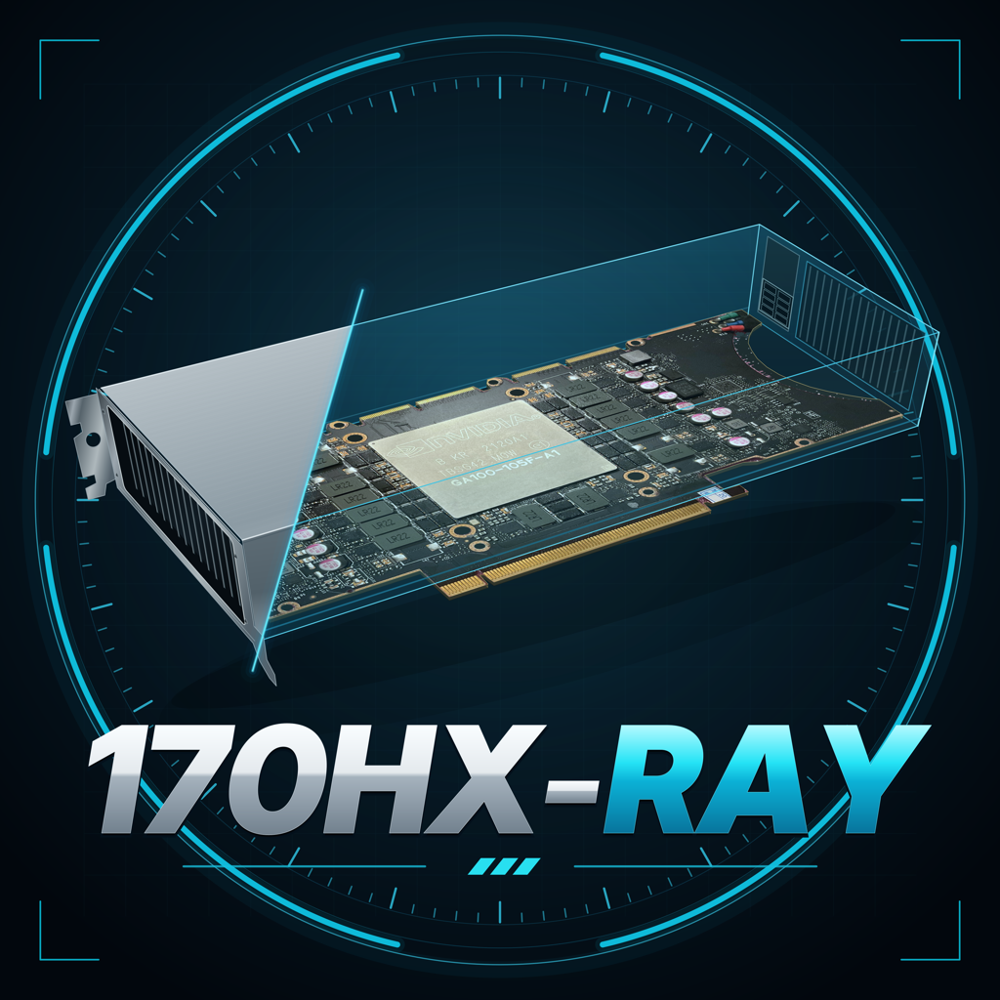

# 170HX-XRAY

> Some historical evidence names below refer to a larger private research
> workspace. They resolve to the [provenance boundary](docs/PROVENANCE.md)
> instead of pretending that unredistributed third-party material ships here.

<p align="center">
  
</p>

**[Usage](./USAGE.md) · [unlock-plan contract](./UNLOCK_PLAN.md) · [public-tool comparison](./docs/TOOL_COMPARISON.md) · [plan models](./docs/PLAN_MODELS.md) · [credits](./docs/CREDITS.md) · [contributing and release gates](./PR.md)**

Clone with the pinned ArchBench dependency:

```sh
git clone --recurse-submodules https://github.com/anoane/170HX-RAY.git
cd 170HX-RAY
```

For an existing clone:

```sh
git -C /path/to/170HX-RAY submodule update --init --recursive
```

Both repositories are public. A recursive clone requires no GitHub credential;
the parent repository still verifies the ArchBench URL, commit and tree against
its checked-in lock.

170HX-XRAY is an evidence-oriented GA100/CMP 170HX observer, physical-row
collector, FF/IFF/RIR decoder, and fail-closed planning tool. It is intended to
answer *what this exact card contains* before anyone proposes an irreversible
change. It is not a turnkey unlock recipe. Version 4.3.0 retains one deliberately
narrow experimental fuse backend: it can append only a reviewed, hash-sealed
record to a verified blank GA100 FF row. It is not a generic fuse/MMIO writer.

The current tool is version 4.3.0. Its Python entry point is
[`170HX-XRAY.py`](./170HX-XRAY.py), and its integrated Linux observation helper is
version 4.1.0 with native LP64 ABI 6 in [`kernel/`](./kernel/). Helper 4.1.0 is
a read-surface revision: it adds the allowlisted NVENC inventory/control
observations at `0x2244c` and `0x820968` without changing ABI 6. Retained
captures that attest helper 4.0.0 remain historical 4.0.0 artifacts. The dedicated
fixed-operation thermal helper is version 1.5.1 with native LP64 ABI 5. XRAY accepts the
immutable RAY 3.6.1/3.7.0 capture and full-dump envelopes only through explicit
read-only compatibility normalization; every newly emitted schema, key, profile
and helper identity uses XRAY. The broader evidence and operational conclusions live
in the [research runbook](docs/PROVENANCE.md#workspace-only-evidence).

ArchBench 0.2.0 is a separately versioned, commit-pinned Git submodule under
[`third_party/archbench_cuda13_5_v0_2_0`](./third_party/archbench_cuda13_5_v0_2_0/)
from [anoane/archbench](https://github.com/anoane/archbench). It is offered under
`AGPL-3.0-or-later`. On the Linux/CUDA host, build the SM80 worker once with
`./bench selftest` and
`./bench build --arch 80`; XRAY then discovers the initialized submodule and
`build/bin/archbench_sm80` automatically. The exact URL, commit and tree are
locked in [`docs/ARCHBENCH_SUBMODULE_LOCK.json`](./docs/ARCHBENCH_SUBMODULE_LOCK.json). The
report verifies the initialized checkout against that lock before execution.
`--archbench-root` selects a separately reviewed tree and automatically derives
its `build/bin/archbench_sm80`; `--archbench-binary` overrides that worker path.

The maintainers retain a complete four-card validated demonstration report,
but it is deliberately not distributed in this source repository: it contains
host/card inventory, raw fuse images, candidate artifacts and command logs.
The [release-validation ledger](./docs/RELEASE_VALIDATION_2026-11-26.md)
records its bounded historical result without republishing the private capture.
Generate a new specimen-local report with `full-report` or
`full-report-bench`; generated `reports/` content is ignored by Git.

The public package includes a first-party public-plan audit and a hash-only
source-lineage descriptor under `evidence/public/`. It does not redistribute or
relicense the referenced raw third-party plan files. Candidate output marks
those bindings `hash_attestation_only: true` and `hash_verified: false` when the
raw bytes are absent.

Historical links below intentionally retain their original `170hx-ray-*`
filenames. Those names identify immutable pre-XRAY evidence and are not current
tool or schema names.

> **`ai-ws` recovery completed (2026-11-17):** after the owner-authorized clean
> reboot, the legacy RAY ABI-5 helper acquired certified two-pass locked-controller MAIN
> and RIR images from all four CMP cards. The conventional/FF portion uses the
> physical controller path; newer cross-plane evidence proves that active IFF
> rows are state-qualified rather than immutable OTP across unlike DSOV/override
> states. NVIDIA, GDM, persistence, power limits and the inference service were
> restored without an Xid or helper fault. See the
> [physical-survey report](docs/PROVENANCE.md#workspace-only-evidence);
> the earlier [maintenance-attempt report](docs/PROVENANCE.md#workspace-only-evidence)
> remains the incident chronology.

> **Exact-current follow-up completed (2026-11-23):** exact legacy RAY 3.6.1
> source and its ABI-5 observation helper acquired passive, all-safe BAR-read, and complete
> helper-certified Level-3 MAIN/RIR observations for all four installed `20c2`
> cards under an exclusive, unbound maintenance window. The sealed full-dump
> contains 12 specimens and 248 exported artifacts; its semantic pass issued
> 4,160 controller reads and 8,336 operational MMIO writes, restored checked
> entry state, and issued zero OTP/programming commands. Independent normal and
> sanitized verifiers agree. This moves exact-current `20c2` observation and
> covered format conversions to GO; it does not validate a live `20b5`/`2080`
> specimen, electrical programming, or a real OTP pulse. See the
> [3.6.1 evidence bundle](docs/PROVENANCE.md#workspace-only-evidence)
> and [3.6.1 validation report](docs/PROVENANCE.md#workspace-only-evidence).

## Current safety boundary

The observation helper deliberately has no generic MMIO-write ioctl, no
`FUSEWDATA` access, no `FUSECTRL.CMD_WRITE`, no software-IFF loader, no fuse
timing setter, no GPIO/program-source control, and no re-sense or reset action.
Its only writes are narrowly defined controller state changes required to read
MAIN FF or RIR rows, followed by checked restoration.

The built-in Python planner produces zero physical operations. `apply` validates
only a hash-bound, non-executable plan skeleton. `apply --execute` is always
refused.
Legacy `170hx-xray-otp-sealed-manifest-v1` input to `full-write` remains an
`EOPNOTSUPP` readiness/refusal path. A distinct
`170hx-xray-otp-sealed-manifest-v2` can enter the experimental VFI blank-FF
append backend. That path requires exact-current same-capture Level-3 evidence,
independent last-record-wins and defect replay, a separately reviewed receipt,
an exact `20c2` BDF/PCI tuple, canonical root-owned journal registry, a live
DSOV=0/CRC=0x55 gate, `EN_SW_OVERRIDE=0` at entry, two exact 512-row passes,
interactive authorization, a fresh native DSOV=0 held-state capture, an
armed-plane recapture, a one-shot test row for non-identity profiles (or the
sealed two-row identity commit group), per-command durable journal, and
independent native cold MAIN/RIR verification. No volatile-write executor exists.

A separate workspace companion, `tools/170hx_candidate_plan.py`, now emits
non-empty, specimen-bound **candidate** images for research comparison. It keeps
public-faithful, public-corrected, specimen-derived, XRAY-best, comparison and
append-only recovery models distinct; reconstructs complete 512-row images;
checks every operation prefix; preserves RIR and active IFF; and remains
`executable=false`. Its independent adversarial oracle proves offline structure
and replay, not electrical safety, bootability, silicon stability or permission
to burn. See [`docs/PLAN_MODELS.md`](./docs/PLAN_MODELS.md).

The transaction contract, review gates, journal states, and host-only fault
simulations are specified in
[`docs/OTP_EXECUTOR_SAFETY_SPEC.md`](./docs/OTP_EXECUTOR_SAFETY_SPEC.md). The
workspace CLI `tools/170hx_otp_executor_spec.py` preserves the older inert v1
oracle. The v2 compiler/reviewer/cold verifier is
`tools/170hx_vfi_append_manifest.py`; the only live v2 transport is the
allowlisted `otp_vfi_append.py` backend shipped beside XRAY.

The public-source faithful/corrected comparison profiles additionally require
the exact externally obtained source artifacts whose paths and SHA-256 values
are recorded in [`docs/PLAN_MODELS.md`](./docs/PLAN_MODELS.md). Those captures
have no confirmed redistribution license and are therefore not bundled here.
Profiles that do not depend on them load no public-source fixture; selecting a
dependent profile without its exact source fails closed.

The remaining refusals are intentional. The available evidence does not yet
establish an authoritative GA100 fuse descriptor, electrical instrumentation
of every board, post-conversion `20b5`/glitch-state `2080` capture, or
feature/stability closure. A passing parser, receipt, or confirmation prompt
cannot replace those facts.

Do not infer safety from any of the following alone:

- the write gate appearing open after a voltage glitch;
- two matching row reads;
- clean macro CRC status;
- an FF record that resembles another card;
- a plan hash;
- a successful software override;
- a public tool accepting a proposed row;
- the claim that an OTP block is currently protected.

OTP programming is monotonic and can permanently brick or misconfigure the
card. No OTP operation is required to use XRAY's implemented features.

## Six-level risk model plus an isolated glitch-read branch

The CLI exposes the original six ordinal levels plus a zero-write observation
branch named `glitch-read`. Calling that branch Level 2G preserves the meaning
of retained “Level-3” MAIN/RIR evidence. Two older spellings remain aliases:
`read-write` means `volatile-write`, and `full-write` means `otp-write` when
used as an `--access` value. An alias does not add a capability.

| Level | Name | Operational behavior | Present support |
|---:|---|---|---|
| 1 | Passive metadata | Reads sysfs/PCI metadata and, unless disabled, invokes query-only NVML/`nvidia-smi` APIs. XRAY calls no setter, but proprietary-driver internal effects are opaque. | Implemented with `--access passive --backend metadata`; add `--no-driver-queries` for the narrowest path. |
| 2 | Allowlisted BAR read | Performs direct `readl()` only at the helper's fixed GA100 allowlist. It issues no device-MMIO write; the hardened helper may take and release a non-waking runtime-PM software reference after proving the device is already active/D0. | Implemented with `--access bar-read --backend xray-helper` (or the legacy `gpcprobe` backend). |
| 2G | Glitch-state pure read | Repeats the allowlisted Level-2 reads, requires driver queries off, and qualifies a transient `2080`/`DSOV=0` phenotype plus inactive EN_SW/IFF/RWL and idle controller context. It issues no device-MMIO write and cannot read MAIN/RIR. | Experimental with `--access glitch-read --no-driver-queries`; `2080` or `DSOV=0` alone fails. It claims neither OTP eligibility nor persistence. |
| 3 | Semantic read | Writes `FUSEADDR`, issues `CMD_READ`, and temporarily sets RIR `DEBUGCTRL.RWL`; captures two passes and restores checked entry state. These are semantically reads but operationally include MMIO writes. | Implemented through the integrated helper. The supported/default posture is an exclusively owned, NVIDIA-driver-unbound card. |
| 4 | Offline plan | Reads an existing artifact, compares explicitly selected evidence models, and emits a hash-bound report with zero operations. | Implemented by `plan --access plan`; it performs no live device access and never imports an external plan as authority. |
| 5 | Volatile write | Would alter software override, software-IFF RAM/window state, or other live configuration without burning OTP. | Named policy level only. Capture downgrades to observation; `apply` is offline dry-run. No volatile executor exists. |
| 6 | OTP/full write | Irreversibly changes storage. | Experimental v2 supports only controller-internal append to verified blank main-array FF rows in a held VFI window. Legacy v1, occupied rows, FPF, IFF, RIR, keys, arbitrary MMIO, GPIO, timing setters, and automatic retry/resume remain refused. The observation kernel module still has no programming ABI. |

The current CLI selectors mean:

- `--access passive`: Level 1; no direct BAR MMIO;
- `--access bar-read`: request Level 2 allowlisted BAR reads;
- `--access glitch-read --no-driver-queries`: request isolated Level 2G
  transient-state qualification with zero XRAY device writes;
- `--access semantic-read`: request Level 3, with fail-closed fallback when the
  ownership/helper preconditions are not met;
- `plan --access plan`: Level 4 offline comparison/planning with no live access;
- `--access volatile-write`: name Level 5, but capture downgrades to the highest
  safe observation level and `apply` remains offline-only;
- `--access otp-write`: name Level 6; capture still downgrades; `full-write` keeps v1
  readiness/refusal and accepts only the separately compiled v2 blank-FF
  manifest for experimental execution.

`read-write` and `full-write` remain accepted as the legacy access aliases
described above.

`semantic-read` is the default selector, but it does not silently override a
busy or bound-device safety gate. `--owner-busy` forces controller operations to
downgrade to passive. `--allow-bound-controller` is a separate high-risk
request and works only if the module was explicitly loaded with
`allow_bound_controller=1`; that configuration is not recommended and must not
be used to probe a card carrying an active workload.

Backend selection is a hard boundary: `metadata` never opens a BAR helper,
`gpcprobe` and `sysfs` can reach only Level 2, and only `xray-helper` or `auto`
can request semantic Level 3. A controller request is limited to one exact target unless
`--all-targets` explicitly acknowledges a sequential multi-card attempt; that
sequence stops at the first uncertified transaction.

With no explicit `--device`, ordinary discovery remains `20c2`. An exact
`--bdf` or `--all-targets` widens discovery only to the hard allowlist
`20c2`/`20b5`/`2080`; arbitrary NVIDIA IDs are refused. `--all-targets` selects
all present allowlisted identities, whereas repeated `--bdf` selects only those
exact full-domain functions.

### Does `nvidia-smi` write state too?

XRAY's `nvidia-smi` and NVML calls are query-only at the public API boundary.
They can still cause the proprietary driver, RM/GSP firmware, runtime-power
management, or telemetry machinery to touch transient state internally. XRAY
cannot prove those internals are zero-write or zero-impact. Each artifact labels
them as opaque driver queries. Use `--no-driver-queries` when that distinction
matters.

Direct physical-row collection is less ambiguous: it necessarily writes
controller address/command state even though the requested information is a
read. XRAY journals and reports those writes rather than calling the operation
"read-only" without qualification.

## Requirements

- 64-bit Linux and 64-bit userspace for live PCI/BAR capture and XRAY helper ABI 6
  (no untested ILP32 compat ioctl is advertised);
- kernel headers matching the running kernel;
- a compiler and Kbuild/`make` for the helper;
- `CAP_SYS_RAWIO` (normally root) for `/dev/170hx_xray`;
- Python 3.9 or newer for the Python tool;
- an explicitly identified NVIDIA GA100 read target: `10de:20c2` CMP 170HX,
  `10de:2080` glitch identity, or post-conversion A100 PCIe `10de:20b5`.
  Live discovery deliberately remains scoped to `20c2` by default; use an
  explicit `--device 0x20b5` after conversion. The `20b5` path is statically
  covered but still requires specimen-level live validation. The helper permits
  allowlisted `READ32` on `20b5`, but defaults to rejecting its MAIN/RIR
  controller transactions with `EOPNOTSUPP`; enabling those additionally
  requires the explicit load-time gate `allow_a100_controller=1`.

The Python implementation uses only the standard library and is written to the
Python 3.9 grammar/API baseline. The release gate runs the complete normal and
sanitized suites under the available CPython 3.9, 3.14 and 3.15 runtimes; exact
counts and hashes belong in the regenerated release ledger because they change
when tests are added. Live kernel behavior remains Linux- and
kernel-version-specific.

Before live use, run:

```sh
python3 170HX-XRAY/170HX-XRAY.py self-test --output xray-self-test.json
```

Run the separate registry/ABI/access regression suite as well:

```sh
python3 -m unittest discover -s 170HX-XRAY/tests -p 'test_*.py' -v
```

This suite locks the Python/kernel allowlist, supported read identities, ABI and
ioctl constants, the absence of programming ioctls, controller-write targets,
provenance census, fail-closed header-conflict behavior, and no-backend fallback
for every access-level name. It is offline and does not touch a GPU.
The current results and remaining hardware gaps are recorded in the
[current release-validation ledger](./docs/RELEASE_VALIDATION_2026-11-26.md).
The [legacy registry/access hardening report](docs/PROVENANCE.md#workspace-only-evidence)
remains historical acquisition provenance.

Output paths are opened exclusively with mode `0600`; XRAY refuses to overwrite
an existing artifact. Choose a new filename for every acquisition.

### Self-contained package layout

The normal research edition now bundles the same reviewed companion CLIs used
by the workspace-level examples:

```text
170HX-XRAY/
  170HX-XRAY.py
  otp_vfi_append.py
  kernel/
  diagnostics/
  tools/
    170hx_candidate_plan.py
    170hx_vfi_append_manifest.py
    170hx_otp_executor_spec.py
    170hx_full_release_bundle.py
```

Commands written as `python3 tools/TOOL.py` assume the workspace root and use
its byte-identical companion copy. For a standalone `170HX-XRAY` directory,
either run from inside that directory with the same spelling or, from its
parent, use `python3 170HX-XRAY/tools/TOOL.py`. The bundled planner and complete-
release packager resolve the adjacent package frontend first, so they cannot
silently select a sibling edition.

## Build and load the observation helper

From the workspace root:

```sh
make -C 170HX-XRAY/kernel
sudo insmod 170HX-XRAY/kernel/170hx_xray.ko \
  allow_bound_controller=0 allow_bound_read32=1 allow_a100_controller=0
sudo python3 170HX-XRAY/170HX-XRAY.py helper-info \
  --controller-helper /dev/170hx_xray \
  --output xray-helper-info.json
```

The device node is mode `0600`, and the module checks `CAP_SYS_RAWIO` again at
open and ioctl time. It allows one open file at a time. The default shown above:

- permits fixed-allowlist `readl()` while NVIDIA owns a card;
- refuses MAIN/RIR controller transactions while any driver owns that card;
- refuses `20b5` MAIN/RIR controller transactions until the separate,
  explicit `allow_a100_controller=1` validation gate is chosen;
- does not change PCI command, runtime-power, driver binding, software
  override, or programming state.

When runtime PM is enabled, Level 2 takes and releases only a non-waking
software reference after proving the device is already active and in PCI D0.
It refuses inactive, non-D0, missing, offline, memory-disabled, or
resource-moved devices; it never requests a runtime resume.

For an even stricter maintenance-only helper, load with
`allow_bound_read32=0`. Do not set `allow_bound_controller=1` merely to avoid an
unbind or to keep a workload running.

Unload after all XRAY processes have exited and every temporarily unbound card
has been returned to its intended driver:

```sh
sudo rmmod 170hx_xray
```

### What the integrated helper adds

The GPL-2.0 helper descends from the small ioctl/BAR-discovery shape of
`matstatman/gpcprobe`, but it does not import that project's Python frontend. It
adds:

- the correct PCI 64-bit memory-BAR type check and real resource-length checks;
- full PCI domain:BDF plus vendor/device/subsystem/revision identity;
- host-visible PCI config dword-0 attestation against both cached and
  map-frozen vendor/device at mapping, inventory and every MMIO boundary;
- generation-bound requests so stale indices cannot silently select a card;
- exact GA100/CMP device and read-offset allowlists;
- `CAP_SYS_RAWIO`, exclusive open, per-card serialization, and nonblocking PCI
  device-lock serialization against bind/unbind/remove;
- PCI-present, D0, active-runtime-PM, memory-decode and exact BAR
  start/length/flags/config revalidation before every MMIO transaction;
- an unbound controller transaction-time BAR0 region claim;
- an unbound-by-default controller policy;
- a separate default-off post-conversion `20b5` controller gate while retaining
  its bounded Level-2 allowlisted read support;
- bounded controller polling with no retry after an uncertain failure;
- a separate bounded cleanup-idle poll that issues no restoration write until
  an interrupted/timed-out controller is proven idle;
- two atomic 512-row MAIN passes and two atomic eight-word RIR passes;
- entry/exit controller, IFF, CRC, security-status, and privilege snapshots;
- exact `FUSEADDR` and RIR-RWL restoration checks;
- a preserved first poison-causing journal; and
- a poisoned-card state after a timeout/restoration/context failure, which
  prevents further transactions until an operator investigates and reloads the
  module.

Every DUMP response is initialized in-kernel; a caller cannot preseed counters,
snapshots, words, restore flags, or the retained journal. XRAY ABI 6 is native
64-bit only and locks structure sizes, critical offsets, and the XRAY-specific
`'X'` ioctl encodings at compile time. Current XRAY userspace cannot open the
retired RAY ABI-5 live protocol. Read-only artifact compatibility is separate
from live UAPI compatibility.

It still cannot coordinate with NVIDIA's proprietary private locks. That is why
the supported Level-3 procedure requires driver unbinding, even though the
helper has its own mutex.

Current XRAY also observes the complete per-GPC TPC layer set exposed by the
current GA100 evidence: physical defect, disable option, RECONFIG option,
control, RECONFIG override, disable-extend and effective status, plus their
privilege masks. `tpc_layer_analysis` reports every raw layer and evaluates
`status=disable|(reconfig&~override)` only when control and disable-extend are
both zero. Its SM arithmetic is observational; absence of a defect bit is never
treated as proof that a unit is healthy or safe to enable.

The topology analysis also keeps HBM architecture, defect, programmed-disable
and effective-status capacity separate. For the Hynix 8-GB CMP geometry it
admits an exact 64/80/96-GiB class only when each 12-bit FBP mask expands to the
same paired 24-bit FBPA, FBIO and ROP/L2 masks. Missing or mismatched planes
produce `unknown`, not an optimistic target. On the four retained cards the
result is 64 GiB current/disable and 80 GiB defect-preserving; their SM layers
are 74 current/disable and 112/124/124/126 defect ceilings. The architectural
96 GiB and 128 SM values are maxima, not specimen health guarantees.

The planner accepts the clearer alias `specimen-hbm-to-defect-ceiling`; its
output retains historical model ID `specimen-80gb-hbm` so existing sealed
artifacts remain stable. The model ID never forces an 80-GiB target.

## Capture workflows

All commands below assume the workspace root as the current directory.

### 1. Metadata-only capture

This is the narrowest implemented live path. It does not open a raw BAR helper
and does not invoke NVML or `nvidia-smi`:

```sh
python3 170HX-XRAY/170HX-XRAY.py capture \
  --access passive \
  --backend metadata \
  --no-driver-queries \
  --output xray-metadata.json
```

Omit `--no-driver-queries` only if query-only driver telemetry is acceptable.
The resulting artifact records which path was used.

### 2. Allowlisted BAR-read capture

With the integrated helper loaded, this collects the curated register set but
does not issue a fuse-controller command:

```sh
sudo python3 170HX-XRAY/170HX-XRAY.py capture \
  --access bar-read \
  --backend xray-helper \
  --controller-helper /dev/170hx_xray \
  --no-driver-queries \
  --output xray-passive-bar.json
```

This issues zero device-MMIO writes, but it is still direct MMIO observation of
live hardware. The XRAY 4.1.0 ABI-6 helper takes a non-waking runtime-PM
reference in kernel software so the mapping cannot become suspended during a
read; it never wakes an inactive device. Current source additionally uses
`READ_ONCE()` for the informational runtime-status sample. Inspect the
artifact's `access`, `safety`, backend,
power state, and coherence fields instead of relying on the filename.

`--register-profile` selects a cumulative, generated pure-read inventory:

| Profile | Unique addresses | Boundary |
|---|---:|---|
| `core` | 209 | Stable controller/topology/feature observations used by ordinary captures. |
| `fuse-reference` | 250 | Adds every safe address from the retained GA100 fuse-reference table. |
| `shadow-full` | 874 | Adds the complete safe GA100 shadow manifest; opt in because some availability responses are architecture/private-state dependent. |
| `hbm-static` | 322 | Adds static HBM broadcast/unicast configuration and status observations. |
| `hbm-i1500-latches` | 442 | Adds safe I1500 address/control/status/WDR latch observations. |
| `all-safe` | 1,066 | Union of every known pure-read address in the registry. |

The 25 stateful I1500 `DATA` ports are catalogued but excluded from all six
profiles and from the kernel allowlist because reading them advances internal
state. The manifest contains 771 names at 770 primary addresses, while aliases
remain resolvable and conflicting definitions are rejected. Use
`registry-audit` to prove exact Python/kernel allowlist equality before a live
deployment. The audit now also emits a confidence/field/source census. Supplying
`--header PATH` mechanically compares safe addresses and matching field ranges
to a compatible direct register header, but never expands the allowlist or
promotes an address to planning authority.

The 2026-11-23 bound-driver `all-safe` survey used 13,080 allowlisted `readl()`
calls over four CMP cards and three passes with zero direct MMIO writes, zero
controller commands and zero OTP commands. It did not replace the earlier
certified MAIN/RIR controller captures. See the retained
[legacy live-survey report](docs/PROVENANCE.md#workspace-only-evidence).

### 3. Atomic MAIN and RIR capture, one card at a time

Level 3 changes controller state and is a maintenance operation. Unbinding a
card interrupts all NVIDIA-driver use of that card. NVIDIA's remove path can
also wait forever if Xorg, persistence, UVM/GDS, or another client retains an
internal reference. First stop or migrate every workload, disable persistence
while the device is still fully present, stop the display manager, verify that
no `/dev/nvidia*` descriptor remains, and confirm the exact full BDF. Do not
start an unbind and then try to remove those owners after NVIDIA has already
removed the device from its public list.

The 2026-11-17 `ai-ws` attempt demonstrated this failure mode. Its recovery
trap could not run because the sysfs write itself never returned. For the next
maintenance window, use a separately reviewed host procedure that records and
restores display-manager and persistence state, and that aborts before unbind
unless all client checks are clean. A minimal preflight includes:

```sh
nvidia-smi --query-compute-apps=gpu_bus_id,pid,process_name --format=csv,noheader
nvidia-smi pmon -c 1
sudo fuser -v /dev/nvidia* /dev/nvidia-caps/* 2>&1 || true
systemctl status display-manager.service --no-pager
```

The absence of a compute process is not enough when Xorg or persistence still
owns the device. Disable persistence for the verified target and stop the
display manager *before* repeating the descriptor checks. If any reference or
driver warning remains, do not unbind.

Example for `0000:c1:00.0` (replace it with the verified target):

```sh
xray_target_bdf=0000:c1:00.0
lspci -Dnns "$xray_target_bdf"
readlink "/sys/bus/pci/devices/$xray_target_bdf/driver"

# Record the entry states while NVML can still identify the card.
xray_pm_entry=$(nvidia-smi -i "$xray_target_bdf" \
  --query-gpu=persistence_mode --format=csv,noheader | tr -d '[:space:]')
xray_display_entry=$(systemctl is-active display-manager.service || true)
xray_helper_loaded=0
sudo nvidia-smi -i "$xray_target_bdf" -pm 0
sudo systemctl stop display-manager.service

# Install recovery before the final client check and detach. Restore only the
# states that were active on entry. This cannot cure a driver removal routine
# that never returns, which is why the zero-client preflight remains mandatory.
xray_recover() {
  if [ "$xray_helper_loaded" -eq 1 ]; then
    if ! sudo rmmod 170hx_xray; then
      echo 'STOP: helper still owns its PCI/BAR reference; manual recovery required' >&2
      return 1
    fi
    xray_helper_loaded=0
  fi
  if [ ! -L "/sys/bus/pci/devices/$xray_target_bdf/driver" ]; then
    printf '%s\n' "$xray_target_bdf" | \
      sudo tee /sys/bus/pci/drivers/nvidia/bind >/dev/null || true
  fi
  if [ "$xray_pm_entry" = Enabled ]; then
    sudo nvidia-smi -i "$xray_target_bdf" -pm 1 >/dev/null || true
  fi
  if [ "$xray_display_entry" = active ]; then
    sudo systemctl start display-manager.service || true
  fi
}
trap xray_recover EXIT HUP INT TERM

# This must find no owner. Any owner aborts before unbind.
if sudo fuser -s /dev/nvidia* /dev/nvidia-caps/* 2>/dev/null; then
  sudo fuser -v /dev/nvidia* /dev/nvidia-caps/* 2>&1 || true
  echo 'STOP: an NVIDIA device still has an owner' >&2
  exit 1
fi

# Do not carry a helper PCI reference/BAR mapping across NVIDIA's detach.
if grep -q '^170hx_xray ' /proc/modules; then
  sudo rmmod 170hx_xray || exit 1
fi

printf '%s\n' "$xray_target_bdf" | \
  sudo tee /sys/bus/pci/drivers/nvidia/unbind

# Load the observation helper only after a clean, completed detach.
sudo insmod 170HX-XRAY/kernel/170hx_xray.ko \
  allow_bound_controller=0 allow_bound_read32=0
xray_helper_loaded=1

sudo python3 170HX-XRAY/170HX-XRAY.py capture \
  --access semantic-read \
  --backend xray-helper \
  --controller-helper /dev/170hx_xray \
  --bdf "$xray_target_bdf" \
  --passes 2 \
  --no-driver-queries \
  --output "xray-${xray_target_bdf}-physical.json"

sudo rmmod 170hx_xray
xray_helper_loaded=0
printf '%s\n' "$xray_target_bdf" | \
  sudo tee /sys/bus/pci/drivers/nvidia/bind
nvidia-smi -q -i "$xray_target_bdf"
xray_recover
trap - EXIT HUP INT TERM
```

Do not unbind all cards at once. Rebind and validate one specimen before moving
to the next. Do not use this workflow on a card still serving inference merely
because the user-space process appears idle.

The helper refuses the transaction unless, among other checks:

- PCI memory decoding remains enabled;
- the PCI function is present, online, in D0, runtime-active (when runtime PM
  is enabled), and its BAR resources/config still match the mapped aperture;
- the target identity and module generation match;
- the controller enters idle with no command pending;
- `DEBUGCTRL` is in its expected normal value;
- software-IFF loading is inactive;
- software override and software-IFF loading are inactive at entry and exit,
  and `IFF_RECORD` remains stable across the transaction;
- both macro CRC halves report present/no error; and
- the driver is unbound (under the recommended module configuration).

For MAIN it reads rows 0–511 twice. For RIR it sets only RWL, reads words 0–7
twice, then restores and verifies the entry RWL and address state. The JSON
contains both passes, hashes, snapshots, operational-write/CMD_READ/completed-
data counts, coherence, restore flags, and the helper journal.

If a transaction reports `EUCLEAN`, a restore flag is false, context changed, or
the card is marked poisoned, do not reload and retry automatically. Preserve
the artifact and kernel log, rebind/recover the card through the known-good
maintenance procedure, and investigate the last journal first. No failed read
justifies an OTP action.

### Bound-controller override

There is an intentionally difficult escape hatch for experiments:

1. load the module with `allow_bound_controller=1`;
2. request `--allow-bound-controller` in Python.

This only bypasses the helper's ownership gate; it does not create mutual
exclusion with RM/GSP or prove that a running workload is unaffected. It should
not be used for the four-card survey or on an inference-active card.

## Offline decode, schema, and planning

Generate the field/register schema:

```sh
python3 170HX-XRAY/170HX-XRAY.py schema --output xray-schema.json
```

When an explicitly supplied compatible GA100 register specification exists, it
can be parsed for literal register and primary/redundant alias pieces. A header
name/address is not treated as a programming coordinate or unlock recipe.

Externally acquired rows can be decoded with explicit boundaries and
provenance:

```sh
python3 170HX-XRAY/170HX-XRAY.py analyze-rows input.json \
  --card 0000:c1:00.0 \
  --fuseless-start START \
  --fuseless-end END \
  --sparse-policy reject \
  --row-view locked_controller \
  --provenance 'describe collector, identity, date, and bounds evidence' \
  --output xray-analysis.json
```

`START` and `END` are placeholders, not recommended values. The official GA100
descriptor is absent. A caller's row-view label does not by itself become trusted
collector attestation. The old `physical` spelling remains accepted for historical
artifacts, but XRAY reinterprets it as a locked controller MAIN view: the active IFF
interval is not claimed immutable across unlike planes. XRAY does not default missing FF records or
missing physical words to zero, does not invent an IFF payload CRC, and does not
re-decode FF/IFF through RIR. Under the recovered software model, RIR affects
the conventional-fuse plane; an RIR target inside the FF/IFF interval is
reported as anomalous.

Build a per-card, goal-specific evidence report:

```sh
python3 170HX-XRAY/170HX-XRAY.py plan xray-capture.json \
  --card 0000:c1:00.0 \
  --goal 80gb_hbm \
  --goal more_sms \
  --goal pcie_gen4_x16 \
  --planning-model compare \
  --reference-plan public-plan.json \
  --output xray-plan.json

python3 170HX-XRAY/170HX-XRAY.py apply xray-plan.json \
  --access volatile-write \
  --output xray-apply-dry-run.json
```

Supported assessment names include `persistent_dsov0`, `80gb_hbm`, `more_sms`, `pcie_gen4_x16`,
`nvlink`, `ecc`, `mig`, `nvdec_nvjpg`, `a100_identity_vbios`,
`oc_frequencies`, and `fuse_write_eligibility`. These are evidence checklists,
not automatic payload generators.

### Current feature-map corrections

The release keeps direct-register identity, physical-coordinate evidence and
feature sufficiency separate. This prevents a readable register name or a
single functional report from becoming an automatic burn recipe.

| Feature | Current interpretation | Planning consequence |
|---|---|---|
| SS0 | `FEATURE_OVERRIDE_SM_SPEED_SELECT` at `0x0082381c`; broad IMLA0-3, FMLA, FFMA and DP override, 95% identity confidence | XRAY reports the external-recipe IFF pair `0x082381fd`, `0x88888888` (target value `0x88888888`, reported rows 484/485) at 85% recipe confidence. It is non-executable and not a portable row allocation. |
| SS1 | `FEATURE_OVERRIDE_SM_SPEED_SELECT_1` at `0x00823820`; IMLA4 override, 95% identity confidence | XRAY reports the external-recipe IFF pair `0x0823823d`, `0x00000008` (target value `0x8`, reported rows 486/487) under the same non-executable boundary. The older “SS1 equals FP64” conclusion is rejected. |
| FP64 | `OPT_SM_SPEED_SELECT_DP` at `0x00820224`, row 6/7 bit 26, 99% coordinate confidence | Adjacent bit 27 is named `OPT_SM_SPEED_SELECT_DP_CONTROL`, but its undo behavior is only 65%-confidence because retained static specimens never vary it and no isolated cold functional result is sealed. |
| ECC | Enable/control at row 6/7 bits 28/29, 99% coordinate confidence | Inventory-only: domain gates, row remapper, firmware/InfoROM policy and a corrected-error test remain open. |
| MIG | SYS_PIPE Chain-1 bits 372..379, 94% coordinate confidence from one reported functional campaign | Experimental candidate only; preserve the distinct per-card SYS_PIPE defect mask and prove profile isolation. |
| NVLink | The option, CP and defect planes are 3-bit global IOCTRL-group masks; `OPT_PERLINK_DISABLE` and its control/status are separate 12-bit planes; `CTRL_OPT_NVLINK` and `STATUS_OPT_NVLINK` are 16-bit planes | The Chain-1 bits 368..370 candidate is only a global prerequisite. It is not a per-link plan or proof of board power, bridge routing, firmware policy, link training or peer traffic. |
| NVDEC | Chain-1 bits 139..143, 90% coordinate confidence | Experimental defect-gated candidate; power, firmware and API validation remain mandatory. |
| NVJPG/OFA | The unordered set of Chain-1 bits `{146,371}` maps to the unordered NVJPG/OFA pair, 88% set confidence and 0% individual-bit attribution | The two bits may be planned only as one inseparable pair when both direct defect bits are clear. |
| NVENC | NVIDIA documents production A100 as having no NVENC. XRAY inventories the 2-bit option/control/defect/status planes and the 5-bit PTOP instance-count register without treating their names as engine-population proof | Explicitly `not-yet-supported`; the PTOP count is read-only inventory and XRAY invents no operation. |

The current public ffcalc media proof is not accepted as a defect gate. When a
stock disable mask is all ones, `STATUS == DISABLE` is true for every possible
defect mask. XRAY reads the distinct NVDEC/NVJPG/OFA/SYS_PIPE defect words and
preserves every defect bit. One retained card is the concrete counterexample:
SYS_PIPE disable `0xfe`, defect `0x80`, and status `0xfe` still compare equal.

The supplied `Double_Precision__SS1.txt` correctly identifies the information
limit around bit 27: bit 26 varies with the FP64 selector, while bit 27 is zero
in every supplied static sample. The supplied `allspark.md` and its hosted
copy are one secondary source, not two independent votes; their per-card row
values, write sequence and broad feature claims are not programming authority.
The SS0/SS1 pairs above are exposed only as catalog/public-model IFF candidates:
they create no `physical_operations`, cannot enter the FF-only v2 append
backend, and do not promote conventional DP/ECC rows 6/7 into executable work.

The four planning models are deliberately separate:

- `evidence-only` reports direct observations and missing evidence without
  proposing a target;
- `public-model` inventories dated public-tool claims and their known limits;
- `cross-checked-theory` emits XRAY's non-authoritative, source-qualified theory
  while retaining every contradiction and blocker;
- `compare` places the last two side by side without resolving an unknown by
  majority vote.

Each `--reference-plan` is recorded only by path, SHA-256, declared schema and
top-level declarations. Its operations are never imported as authority.
Physical operations remain empty under every model.

### Strict dump compatibility

Inspect the supported grammars and loss boundaries with:

```sh
python3 170HX-XRAY/170HX-XRAY.py dump-formats --output xray-formats.json
```

`analyze-rows` and `convert-dump` accept strict XRAY, indexed text, Danylo JSONL,
xPatrik/kprinssu, `ga100-fuse-re`, and current/legacy Danylo backup structures;
raw little-endian input is never guessed. Outputs include portable XRAY JSON,
indexed text, raw u32le, Danylo JSONL, `ga100-fuse-re`, ffcalc, xPatrik and an
explicitly nonconformant Danylo-shaped projection.

Strict indexed text accepts only a complete row syntax on each non-comment line;
unknown headings and trailing tokens are errors. Automatic text detection may
ignore only explicit `[INFO]`, `[WARN]`, `[WARNING]`, `[ERROR]`, or `[DEBUG]`
log lines. Numeric row aliases such as `"1"` and `"0x1"`, multiple competing
JSON row containers, and inconsistent redundant portable-XRAY row views are
rejected instead of being resolved by parser order.

Conversions preserve unknown rows as unknown and refuse full-image output from
sparse input. Formats shaped for an actionable public burner (`ffcalc-json`,
`xpatrik-json`, and `dstoro-projection-json`) are refused unless the caller adds
`--allow-unsafe-projection`; that flag acknowledges serialization loss only and
never grants planning or write authority. A XRAY projection cannot masquerade as
an authentic Danylo backup. Every metadata-bearing projection includes a loss
report, and controller/identity claims are retained only when the source really
contained them.

Danylo backup recognition remains distinct from authority: MAIN and RIR content
digests must verify before a claimed backup is imported, while the map hash is
still reported as an unrecomputed claim unless its exact source maps accompany
the artifact. ffcalc logical `option_words`, including unknown future keys, are
carried through portable XRAY and restored by ffcalc export; their represented and
omitted key sets are explicit in the conversion loss report.

From the release directory, run the standalone parser/registry regression suite with:

```sh
python3 -m unittest discover -s tests -v
```

The plan's canonical SHA-256 detects accidental/tampering changes within the
artifact. It is unkeyed, so it is not a signature, independent review, or
authorization. The invariant is that unknown evidence remains unknown: it is
never silently replaced with zero or copied from another GPU.

Inspect the deliberately blocked legacy-v1 OTP-readiness state with:

```sh
python3 170HX-XRAY/170HX-XRAY.py full-write xray-plan.json \
  --access otp-write \
  --output xray-full-write-readiness.json
```

For a legacy v1 manifest, that command exits successfully after emitting `ready: false`, the complete
blocker list, the required lifecycle, and zero-write counters. Adding
`--execute` requires an interactive TTY and exact typed acknowledgements of the
plan-file hash, ordered target list, and operation count. Regardless of those
answers, XRAY invokes no backend, writes no register, emits `EOPNOTSUPP`, and
exits with status 3. The confirmation-only UX is testable scaffolding, not a
way to authorize or perform OTP work. The distinct v2 workflow is documented
below and never reinterprets a v1 file.

## Experimental v2 blank-FF append lifecycle

This is the complete command surface for the implemented Level-6 backend. It
does not make a card, manifest, or glitch state safe. Run one profile on one
exact BDF at a time. Filenames below are examples; XRAY refuses to overwrite
artifacts, journals, or bundles.

The seven profile classes that currently survive the independent v2 compiler are
`specimen-80gb-hbm` (historical ID; dynamically targets the specimen's 64/80/96-GiB defect ceiling), `specimen-more-sm`, `xray-common-permanent-topology`,
`specimen-pcie-gen4-isolated`, `specimen-a100-20b5-identity`, the explicitly
lower-confidence `specimen-sys-pipe-to-defect-experimental`, and the defect-gated
`specimen-media-mig-to-defect-experimental`. The media profile orders SYS_PIPE
before NVDEC and treats bits 146/371 as one inseparable NVJPG/OFA pair; it does
not invent an NVENC coordinate. Composite/public
profiles containing unexplained `WHOLE_WORD_EMPIRICAL` changes are deliberately
rejected by v2 even though the candidate planner still emits them for
comparison. Passing v2 proves internal consistency, not an official GA100
descriptor or feature sufficiency.

The retained XRAY 4.0.0 freeze contains four cards × eleven historical research
profiles in
[`170hx-xray-specimen-plans-exact-current-level3-native-v4.0.0-2026-11-23.json`](docs/PROVENANCE.md#workspace-only-evidence)
and four cards × seven then-admitted policies in the
[`28-manifest matrix`](docs/PROVENANCE.md#workspace-only-evidence).
Those 28 historical manifests are offline-verified and explicitly unauthorized. They were
regenerated from the immutable RAY ABI-5 capture through input-only
normalization; the retained source bytes and digests were not rewritten. Current
code emits 18 candidate profiles: twelve candidate-plan profiles and six
zero-operation review-only profiles. It admits seven compiler/runtime profile
classes, so a fresh complete four-card matrix has 28 manifests and must be
generated and verified from exact-current evidence rather than relabeling the
historical 4.2 32-manifest result. `specimen-nvlink-global` remains available
for offline candidate review only: Chain-1 bits 368--370 are global IOCTRL
group disables, not the twelve-link physical map, so the compiler and backend
reject it. See [`UNLOCK_PLAN.md`](UNLOCK_PLAN.md) for the code-locked admission
and evidence contract. The seven current-baseline manifests for one card are
siblings, not seven ordered operations: applying any one makes the other six
stale.

`xray-common-permanent-topology` is the preferred common foundation for either
dual-path end state: it seals FBIO/FBPA/shared ROP-L2, then TPC0..7/PES, then
activates FBP, then activates GPC, and stops for cold validation before any PCIe,
identity or VBIOS change. PCIe requires a new exact-current rebase; NVLink is
excluded from both routes and remains rejected/research-only. The separate
memory and compute profiles remain available for isolated research and
regression comparisons.

### 1. Generate an exact-current candidate

Use the same native Level-3 artifact for MAIN, RIR, identity, and ordinary
register context. A cross-date Level-2 candidate is refused:

```sh
python3 tools/170hx_candidate_plan.py \
  --root . \
  --physical-capture /absolute/path/to/exact-level3-capture.json \
  --physical-card 0000:01:00.0 \
  --same-capture-context \
  --xray 170HX-XRAY/170HX-XRAY.py \
  --output candidate-exact-current.json
```

For a multi-card artifact, repeat `--physical-capture` and
`--physical-card` in matching order. To reduce review surface, add one or more
`--profile PROFILE_ID` selectors. The candidate remains non-executable.

### 2. Compile one v2 manifest

The two binary inputs must be the exact 512-word MAIN and eight-word RIR images
bound by the candidate. The compiler reopens and hashes the named capture,
replays every logical block and field target, validates the corrected PCIe
bit-9 transition, checks 16 untouched reserve rows, and seals only one BDF and
one profile:

```sh
python3 tools/170hx_vfi_append_manifest.py compile \
  --candidate candidate-exact-current.json \
  --bdf 0000:01:00.0 \
  --profile specimen-hbm-to-defect-ceiling \
  --cold-main /absolute/path/to/main-pass-001.raw-u32le.bin \
  --cold-rir /absolute/path/to/rir-pass-001.raw-u32le.bin \
  --output 0000-01-00-0-80gb-v2.json

python3 tools/170hx_vfi_append_manifest.py verify \
  --manifest 0000-01-00-0-80gb-v2.json

python3 170HX-XRAY/170HX-XRAY.py full-write \
  0000-01-00-0-80gb-v2.json \
  --bdf 0000:01:00.0 \
  --profile specimen-hbm-to-defect-ceiling \
  --output v2-offline-validation.json
```

The last command must say `OFFLINE_V2_VALIDATED` and perform no hardware access.
It is useful as an independent dispatch/loader check.

### 3. Create and verify the review receipt

`review` requires a real TTY and exact typed values. It creates a new receipt;
it is an experimental owner review, not a production signature:

```sh
python3 tools/170hx_vfi_append_manifest.py review \
  --manifest 0000-01-00-0-80gb-v2.json \
  --output 0000-01-00-0-80gb-v2.review.json

python3 tools/170hx_vfi_append_manifest.py verify-receipt \
  --manifest 0000-01-00-0-80gb-v2.json \
  --receipt 0000-01-00-0-80gb-v2.review.json
```

Any manifest change invalidates the receipt. A self-hash is tamper evidence,
not hostile-local-root security; a privileged operator can replace software.

### 4. Run a live no-OTP preflight

The exact card must be driver-unbound and held at DSOV=0. Preflight takes two
complete 512-row controller passes and checks every gate, but never sets
`EN_SW_OVERRIDE`, never issues `SENSE`, and never issues `CMD_PROGRAM`:

```sh
sudo python3 170HX-XRAY/170HX-XRAY.py full-write \
  0000-01-00-0-80gb-v2.json \
  --live-preflight \
  --bdf 0000:01:00.0 \
  --profile specimen-hbm-to-defect-ceiling \
  --output v2-live-preflight.json
```

A normal locked card (`DSOV=1`) must refuse. A favorable glitch phenotype is
still only a gate; it does not authorize a pulse. Production execution accepts
only the real `/sys/bus/pci/devices`, real host boot ID, and canonical
root-owned `/var/lib/170hx-xray/otp` registry. CLI options cannot redirect the
lock, unresolved-journal scan, or boot evidence. Execution additionally requires
the exact unbound function's `driver_override` to contain the ownership sentinel
`170hx-xray-otp-lock`; that sentinel and the BAR resource identity are re-attested
before every irreversible command.

### 4a. Choose and review the transaction strategy

Execution never infers a setup/sense order. `--write-strategy` is mandatory with
`--execute`, enters the typed confirmation, authorization binding and durable
journal, and may be one of:

- `public-direct-compat`: a controlled comparison with the public tools. After
  all passive gates, it requires `RESENSE_DISABLE[0]=0`, issues exactly one
  unconditional `CMD_SENSE=3` while EN remains zero, requires controller idle,
  sense-done, EFP1, DFP0 and the one-shot `RESENSE_DISABLE=1` transition, then
  sets/read-verifies EN1 and clears/read-verifies SBFE and secure WDATA before
  binding the armed plane.
- `evidence-led-guarded`: the recommended experimental specification. It
  sets/read-verifies EN1 first, then issues one sense only when the sealed initial
  EFP is zero; initial EFP1 skips sense. A performed sense requires
  `RESENSE_DISABLE[0]=0`, controller idle, sense-done, EFP1, DFP0 and the
  one-shot `RESENSE_DISABLE=1` transition before the same SBFE/WDATA and
  armed-plane checks.

Neither strategy writes the fuse timing registers or `RESENSE_DISABLE`. The
backend snapshots `FUSECTRL`, the timing/config words and resense state and binds
the exact transaction trace. Strategy selection changes setup and verification
cadence only; it cannot change the sealed rows, words, fields, one-shot rule, or
cold-verification requirement. The public-compatible order is not a safety
recommendation.

### 5. Execute one test row (non-identity profiles only)

The safest supported irreversible shape is one sealed row followed by a full
power removal, cold capture, and a newly generated plan. The journal path must
be new, reside directly in the canonical registry, and begin with the normalized
BDF:

```sh
sudo install -d -m 0700 /var/lib/170hx-xray/otp

sudo python3 170HX-XRAY/170HX-XRAY.py full-write \
  0000-01-00-0-80gb-v2.json \
  --execute \
  --test-row-only \
  --write-strategy evidence-led-guarded \
  --bdf 0000:01:00.0 \
  --profile specimen-hbm-to-defect-ceiling \
  --receipt 0000-01-00-0-80gb-v2.review.json \
  --held-state-capture /absolute/path/to/fresh-held-dsov0-capture.json \
  --journal /var/lib/170hx-xray/otp/0000-01-00-0-session-001.jsonl \
  --output v2-test-row-result.json
```

The held-state capture must be a fresh (at most 300 seconds old), native,
helper-certified, two-pass Level-3 artifact from this exact `20c2` function and
DSOV=0 window. Rows 0..487 must still equal the cold image, the live RIR must
equal the sealed baseline, and rows 488..511 bind the state-qualified IFF
suffix. The backend requires exact TTY confirmations. It rechecks the complete
gate set after every setup mutation. If initial `EFP_STATUS=0` it issues exactly
one `CMD_SENSE`; if initial `EFP_STATUS=1` it must skip `SENSE`. It then captures
and binds two complete armed-plane MAIN passes before the first program command,
commits a durable attempt token before `CMD_PROGRAM=2`, never retries, reads
back the row, and takes two complete expected-image passes after every row. Any
poison or uncertain/setup state is quarantined and requires complete power
removal; no cleanup MMIO is attempted after poison.

Without `--test-row-only`, a multi-row manifest stops after the first verified
row for another exact controlling-TTY phrase, journals that authorization, then
continues in sealed order. To reproduce the separately labelled public sequence
for comparison, replace the strategy value with `public-direct-compat`; do not
omit it. Prefer the one-row/cold/replan loop until the exact board and held-window
procedure have independent electrical qualification.

The `specimen-a100-20b5-identity` profile is the intentional exception: it
forbids `--test-row-only` and the optional first-row pause, and seals a minimum
two-operation DEVIDA/DEVIDB commit group. This reduces, but cannot eliminate,
the risk of an inconsistent identity after a crash between the two OTP rows.

### 6. Cold verification

After physically removing complete slot and auxiliary power, recapture two
complete MAIN passes and two complete RIR passes. Create a power attestation
that binds the exact manifest and terminal journal event. The required shape is:

```json
{
  "schema": "170hx-xray-power-cycle-attestation-v1",
  "operator_confirmed": true,
  "operator": "NAME",
  "method": "complete-slot-and-aux-power-removal",
  "slot_power_removed": true,
  "aux_power_removed": true,
  "complete_power_loss_measured": true,
  "host_remained_powered": false,
  "powered_off_utc": "YYYY-MM-DDTHH:MM:SSZ",
  "powered_on_utc": "YYYY-MM-DDTHH:MM:SSZ",
  "manifest_content_sha256": "MANIFEST_CONTENT_SHA256",
  "journal_last_event_sha256": "TERMINAL_EVENT_SHA256",
  "bdf": "0000:01:00.0",
  "post_cold_identity": {
    "domain_bdf": "0000:01:00.0",
    "vendor": "0x10de",
    "device": "0x20c2"
  }
}
```

If the host remained powered while independently measured slot/AUX power was
removed, set `host_remained_powered` true; otherwise the host boot ID must
change. The attestation is an owner statement, not a measurement instrument or
signature.

```sh
python3 tools/170hx_vfi_append_manifest.py cold-verify \
  --manifest 0000-01-00-0-80gb-v2.json \
  --journal /var/lib/170hx-xray/otp/0000-01-00-0-session-001.jsonl \
  --post-cold-capture /absolute/path/to/native-post-cold-level3.json \
  --power-attestation power-cycle-001.json \
  --output /var/lib/170hx-xray/otp/0000-01-00-0-session-001.jsonl.cold.json
```

The cold receipt closes the registry blocker only when both MAIN images equal
the exact attempted prefix, both RIR images equal the baseline, the expected
post-cold PCI identity matches, and power/boot bindings pass. Its status
`COLD_PERSISTENCE_VERIFIED` does **not** claim planner no-op or feature
stability; the receipt explicitly leaves both false. Regenerate the candidate
from the cold capture, require the old operation to become a no-op, then run the
profile-specific functional/stress plan before considering another row.

### Refusal and recovery rules

- Never reuse a journal name, row attempt, receipt, or manifest after any byte
  changes.
- `REFUSED` is valid only before volatile setup begins. Any failure after
  `SETUP_INTENT` is `QUARANTINED`, even if no OTP pulse was observed.
- A `PENDING_COLD_VERIFY`, `TEST_ROW_PENDING_COLD_VERIFY`, or `QUARANTINED`
  journal blocks another session for that BDF. Only a valid canonical cold
  receipt closes a verified pending session; quarantine still requires a new
  evidence/review decision.
- `0x058009c2` is permanently rejected. The evidence-backed Gen3 transition is
  block 39 `0x0782 -> 0x0582`, clearing bit 9 and preserving bit 1.
- FUSERDATA is data: `0xffffffff` or a `BADx`-shaped word may be legitimate in
  a sealed row. Controller/address/gate poison is terminal, while row data is
  classified against the exact expected image.
- The v2 backend starts only from an exact live `20c2`; an identity profile may
  expect `20b5` after cold boot. Live `20b5` and `2080` controller capture
  remain separate specimen-validation gates.

## Full-dump bundles

`full-dump` is the reproducible collection and packaging front end. It can
orchestrate ordinary observation levels up to an explicit ceiling, import retained
captures without touching hardware, export every compatible transport, run all
four non-executable planning models, and seal the result with a machine-readable
index plus a sorted SHA-256 manifest.

It does **not** infer permission from its name. The default live ceiling is
`passive`. Level 2 requires `--max-access bar-read`; semantic Level 3 requires
`--max-access semantic-read`. The transient Level-2G branch is intentionally not
inserted into that prefix: use `--max-access glitch-read` or
`--level glitch-read`, which captures that level alone. Mixing it with another
`--level` is refused so a prior controller write cannot contaminate a claimed
zero-write window. `apply` and `full-write` are invoked only in
their non-executing offline validation/readiness modes.

The output directory must not exist. XRAY creates it as mode `0700`, creates
every contained directory as `0700`, and creates every file as `0600`. There is
no overwrite or in-place replacement option. Use a new timestamped directory,
verify it, and only then retire an older bundle through a separate deliberate
workflow.

### What a complete bundle contains

The layout uses stable ordinal names so paths do not depend on untrusted card
labels:

```text
xray-bundle/
├── index.json
├── SHA256SUMS
├── bindings/
│   └── index.json                         # only when bindings were requested
├── inputs/
│   └── rir/original.bin                   # only with --rir-input
└── levels/
    └── LEVEL/                              # passive/bar-read/semantic-read/
        │                                   # glitch-read or imported-NNN
        ├── observation/
        │   ├── capture.json                # live level, or imported-source.bin
        │   ├── capture.jsonl               # live: one complete card per line
        │   ├── capture.txt
        │   └── capture-registers-card-address-value-u32le.bin
        └── specimens/specimen-NNN/
        ├── exports/
        │   ├── main/pass-NNN/
        │   │   ├── xray.json
        │   │   ├── xray.jsonl
        │   │   ├── indexed.txt
        │   │   ├── raw-u32le.bin
        │   │   ├── ffcalc.json
        │   │   ├── xpatrik.json
        │   │   ├── ga100-fuse-re.json
        │   │   ├── dstoro-projection.json
        │   │   └── dstoro.jsonl
        │   ├── registers/
        │   │   ├── registers.json
        │   │   ├── registers.jsonl
        │   │   ├── registers.txt
        │   │   └── registers-address-value-u32le.bin
        │   └── rir/
        │       ├── all-passes.json
        │       └── pass-NNN/
        │           ├── raw-u32le.bin
        │           ├── indexed.txt
        │           ├── rows.json
        │           └── rows.jsonl
        └── planning/
            └── MODEL/
                ├── plan.json
                ├── plan.jsonl
                ├── plan.txt
                ├── plan-canonical-json.bin
                ├── apply-dry-run.json
                └── otp-readiness.json
```

`MODEL` is each of `evidence-only`, `public-model`,
`cross-checked-theory`, and `compare`. Every generated plan remains
`executable=false` with zero physical operations. Candidate planners can be
bound by hash, but `full-dump` never imports or executes their code.

To package the complete already-generated planning surface without weakening
that acquisition boundary, use the separate hardware-inert
`tools/170hx_full_release_bundle.py`. It verifies an existing full-dump, a
current four-card × 18-profile candidate, and the complete four-card ×
seven-profile sealed-v2 matrix. It then exports every proposed 512-row image as
JSON, JSONL, indexed text and raw u32le, copies all 28 manifests, preserves all
read transports, embeds the exact frontend/planner/compiler/validator/backend
dependencies needed for semantic verification, and emits one strict index plus
`SHA256SUMS`. Packager 0.3.0 verifies from those bundled dependencies after the
directory is relocated; it never executes the planner or OTP backend:

```sh
python3 tools/170hx_full_release_bundle.py build \
  --full-dump-bundle /absolute/path/to/verified-full-dump/bundle \
  --candidate /absolute/path/to/exact-current-candidate.json \
  --manifest-set /absolute/path/to/verified-28-manifest-set \
  --output /absolute/path/to/new-complete-read-plan-bundle

python3 tools/170hx_full_release_bundle.py verify \
  --bundle /absolute/path/to/new-complete-read-plan-bundle
```

Read-level coverage is explicit. A stock ordinary bundle can be complete for
passive/BAR/semantic observations while recording `glitch-read` as unavailable,
`fabricated=false`; a missing `2080`/`DSOV=0` specimen is never synthesized.
The historical XRAY 4.0.0 package has 552 verified entries, 44 candidate plans,
28 manifests, and five additional semantic-verifier dependencies; see the
[`complete-bundle report`](docs/PROVENANCE.md#workspace-only-evidence).

`index.json` records the source observation and selector for every specimen,
identity claims, every output status/path, all omitted or unavailable products,
planner bindings, per-file hashes/sizes, and a completion summary.
`SHA256SUMS` covers every regular file except itself, including `index.json`.
The manifest establishes self-consistency, not authenticity: it is unkeyed and
is not a signature or independent acquisition attestation.

### Output formats and gates

For every available MAIN pass, XRAY attempts the following:

| Output | Completeness requirement | Extra gate |
|---|---|---|
| portable XRAY JSON | sparse allowed | none |
| native XRAY JSONL | sparse allowed | none |
| indexed text | sparse allowed | none |
| raw u32le | exactly 512 known rows | none |
| ffcalc JSON | every row in the explicit FF interval | `--include-unsafe-projections` and explicit bounds |
| xPatrik JSON | every row in the explicit FF interval | `--include-unsafe-projections` and explicit bounds |
| `ga100-fuse-re` JSON | exactly 512 known rows | none |
| Danylo-shaped XRAY projection | complete MAIN plus exact RIR | `--include-unsafe-projections` |
| Danylo JSONL | exactly 512 known rows | none |

The three gated formats resemble inputs consumed by public planning/burning
tools. Without the explicit opt-in, their index entries say
`not_requested_policy_gate` and no files are created. The opt-in permits only
serialization. It does not validate field semantics or authorize a write.

RIR is exported only from an exact eight-word source. Native XRAY captures carry
both the repeated passes and a redundant first-pass `rows` vector; import
cross-checks those views and rejects a mismatch. Missing or malformed RIR is
recorded rather than replaced with zeros.

Every live card also carries an `unknown_register_census`. It gives every
catalogued address one of four explicit dispositions: acquired with field
decode, acquired raw with unknown field semantics, safe but not requested or
not acquired stably, or deliberately not read because it is stateful/unsafe.
XRAY never converts “unknown” into permission for an arbitrary BAR sweep. The
25 known I1500 DATA ports remain unread, and uncatalogued offsets are reported
as outside the catalog rather than probed speculatively.

### Exit status and partial evidence

- Exit `0`: every explicitly requested applicable acquisition/export/planning
  product completed. Policy-gated formats that were not requested may be listed
  as unavailable without making the bundle partial.
- Exit `2`: a requested level or product was unavailable. A valid partial
  bundle still has `index.json`, `SHA256SUMS`, exact failure records, and no
  fabricated rows.
- Fatal interruption/finalization error: XRAY attempts to create `failure.json`.
  A directory without a valid index and manifest is incomplete and must not be
  used as evidence.

A semantic-read request that downgrades to BAR or passive remains a failed
semantic-read request even if the lower-level capture is useful. A controller
transaction is complete only when both coherent MAIN and coherent RIR evidence
exist for the card. Owner-busy refusal, helper absence, card absence, sparse
MAIN, missing RIR, parser rejection, and planning incompatibility all remain
explicit.

### Offline examples (no device access)

Package one retained XRAY capture with the default export safety policy:

```sh
python3 170HX-XRAY/170HX-XRAY.py full-dump xray-bundle-001 \
  --no-live-capture \
  --source retained-level3.json \
  --row-view locked_controller \
  --provenance 'retained helper capture; identity and date in source'
```

Package four one-card captures. They remain separate observations and receive
deterministic specimen ordinals:

```sh
python3 170HX-XRAY/170HX-XRAY.py full-dump xray-bundle-four-cards \
  --no-live-capture \
  --source card-01.json \
  --source card-41.json \
  --source card-82.json \
  --source card-c1.json \
  --row-view locked_controller
```

Emit every supported MAIN format, including the three explicitly gated public
projections. `START`/`END` must come from separately documented evidence; they
are not recommended values and are not inferred by XRAY:

```sh
python3 170HX-XRAY/170HX-XRAY.py full-dump xray-bundle-all-formats \
  --no-live-capture \
  --source retained-level3.json \
  --include-unsafe-projections \
  --fuseless-start START \
  --fuseless-end END \
  --row-view locked_controller \
  --bounds-provenance 'exact source/date/reason for these bounds'
```

Package a standalone 512-word MAIN binary and a separate eight-word RIR binary:

```sh
python3 170HX-XRAY/170HX-XRAY.py full-dump xray-bundle-raw \
  --no-live-capture \
  --source main-u32le.bin \
  --input-format raw-u32le \
  --rir-input rir-u32le.bin \
  --rir-input-format raw-u32le \
  --row-view unknown \
  --provenance 'raw collector and hash documented separately'
```

Bind, but do not execute, an external candidate planner and comparison plans:

```sh
python3 170HX-XRAY/170HX-XRAY.py full-dump xray-bundle-bound \
  --no-live-capture \
  --source retained-level3.json \
  --candidate-planner tools/170hx_candidate_plan.py \
  --reference-plan public-plan-a.json \
  --reference-plan public-plan-b.json
```

When working in the research workspace, the explicit discovery flag can bind
the adjacent candidate planner if present:

```sh
python3 170HX-XRAY/170HX-XRAY.py full-dump xray-bundle-bound \
  --no-live-capture \
  --source retained-level3.json \
  --bind-workspace-candidate
```

Restrict every plan model to selected goals:

```sh
python3 170HX-XRAY/170HX-XRAY.py full-dump xray-bundle-sm-pcie \
  --no-live-capture \
  --source retained-level3.json \
  --goal more_sms \
  --goal pcie_gen4_x16
```

### Live examples and access ceilings

Metadata only, with driver queries disabled for the narrowest implemented live
path:

```sh
sudo python3 170HX-XRAY/170HX-XRAY.py full-dump xray-live-passive \
  --max-access passive \
  --backend metadata \
  --no-driver-queries
```

Capture Level 1 and Level 2 separately, using the actual misc-device name:

```sh
sudo python3 170HX-XRAY/170HX-XRAY.py full-dump xray-live-bar \
  --max-access bar-read \
  --backend xray-helper \
  --controller-helper /dev/170hx_xray \
  --bdf 0000:01:00.0 \
  --register-profile all-safe \
  --no-driver-queries
```

On an exclusively owned, driver-unbound maintenance card, capture ordinary
Levels 1, 2, and 3 as three independent observations:

```sh
sudo python3 170HX-XRAY/170HX-XRAY.py full-dump xray-live-semantic \
  --max-access semantic-read \
  --backend xray-helper \
  --controller-helper /dev/170hx_xray \
  --bdf 0000:01:00.0 \
  --register-profile all-safe \
  --passes 3 \
  --no-driver-queries \
  --row-view locked_controller \
  --provenance 'exclusive unbound maintenance capture; session log retained'
```

During a separately obtained `2080` transient window, capture only the
zero-device-write Level-2G phenotype. The command returns exit `2` unless every
selected card proves the complete repeated-read qualification; it never reads
MAIN/RIR and never claims the fuse-program gate is usable:

```sh
sudo python3 170HX-XRAY/170HX-XRAY.py full-dump xray-live-glitch-window \
  --level glitch-read \
  --backend xray-helper \
  --controller-helper /dev/170hx_xray \
  --bdf 0000:01:00.0 \
  --register-profile all-safe \
  --no-driver-queries
```

For multiple explicitly selected, exclusively owned cards, acknowledge the
sequential semantic Level-3 attempt. The sequence stops after the first uncertified
transaction:

```sh
sudo python3 170HX-XRAY/170HX-XRAY.py full-dump xray-live-four \
  --max-access semantic-read \
  --backend xray-helper \
  --controller-helper /dev/170hx_xray \
  --bdf 0000:01:00.0 \
  --bdf 0000:41:00.0 \
  --bdf 0000:82:00.0 \
  --bdf 0000:c1:00.0 \
  --all-targets \
  --register-profile all-safe \
  --no-driver-queries
```

To request the complete ordinary covered product set—three live observation levels,
every compatible MAIN/RIR transport, every goal, all four offline plan models,
and a hash binding to the candidate planner—use a new output directory and the
explicit projection gate. The `222..511` interval below is the empirical bound
for the retained four-card population, not an official GA100 descriptor:

```sh
xray_source_sha=$(sha256sum 170HX-XRAY/170HX-XRAY.py | awk '{print $1}')

sudo python3 170HX-XRAY/170HX-XRAY.py full-dump xray-live-four-complete \
  --max-access semantic-read \
  --backend xray-helper \
  --controller-helper /dev/170hx_xray \
  --bdf 0000:01:00.0 --bdf 0000:41:00.0 \
  --bdf 0000:82:00.0 --bdf 0000:c1:00.0 \
  --all-targets --passes 3 --register-profile all-safe \
  --no-driver-queries --invoked-source-sha256 "$xray_source_sha" \
  --fuseless-start 222 --fuseless-end 511 \
  --bounds-provenance 'empirical four-card 20c2 bound; not official GA100' \
  --sku 8gb --row-view locked_controller \
  --include-unsafe-projections \
  --candidate-planner tools/170hx_candidate_plan.py \
  --provenance 'exclusive unbound maintenance capture; session log retained'
```

The projection gate changes serialization only; it does not grant planning or
write authority. A successful four-card run has three observations and twelve
specimens. Treat any different count, `PARTIAL` completion, or nonzero OTP
counter as a stop condition requiring investigation.

If workloads are active, declare that fact. A semantic request then records an
owner-busy downgrade/refusal; it does not transact with the fuse controller:

```sh
sudo python3 170HX-XRAY/170HX-XRAY.py full-dump xray-live-busy \
  --max-access semantic-read \
  --owner-busy \
  --backend xray-helper \
  --controller-helper /dev/170hx_xray \
  --bdf 0000:01:00.0
```

Do not add `--allow-bound-controller` merely to turn a partial bundle green.
That option requires a separately configured helper and accepts an unresolved
RM/GSP mutual-exclusion risk; the resulting evidence must retain that fact.

### Verification and consumption examples

Verify hashes, the exact file set, index linkage, file modes, directory modes,
and absence of symlinks:

```sh
python3 170HX-XRAY/170HX-XRAY.py verify-full-dump xray-bundle-001 \
  --output xray-bundle-001-verification.json
```

For a verification report inside the bundle, generate it **before** sealing by
an external controlled workflow or keep it outside as above. Adding any file to
an already sealed directory intentionally causes an exact-file-set failure.

Check the manifest with a standard utility as an additional transport check:

```sh
(cd xray-bundle-001 && sha256sum --check SHA256SUMS)
```

Inspect completion and unavailable products without treating them as zeros:

```sh
python3 - <<'PY'
import json
from pathlib import Path
d = json.loads(Path('xray-bundle-001/index.json').read_text())
print(d['completion'])
for item in d['unavailable']:
    print(item['category'], item['reason'])
PY
```

Re-import one binary MAIN export and one RIR export through the strict parser:

```sh
python3 170HX-XRAY/170HX-XRAY.py convert-dump \
  xray-bundle-001/levels/imported-001/specimens/specimen-001/exports/main/pass-001/raw-u32le.bin \
  --input-format raw-u32le \
  --output-format xray-json \
  --output reimported-main.json

python3 170HX-XRAY/170HX-XRAY.py analyze-rows \
  xray-bundle-001/levels/imported-001/specimens/specimen-001/exports/main/pass-001/raw-u32le.bin \
  --input-format raw-u32le \
  --rir-input xray-bundle-001/levels/imported-001/specimens/specimen-001/exports/rir/pass-001/raw-u32le.bin \
  --rir-input-format raw-u32le \
  --fuseless-start START \
  --fuseless-end END \
  --sparse-policy reject \
  --row-view locked_controller \
  --output reimported-analysis.json
```

Never repair a failed manifest by recomputing hashes in place. Preserve the
failed bundle, determine whether the cause is transfer damage, tampering, or an
unexpected added file, and create a new bundle from the retained source.

## Fast full report and full report plus benchmarks

The `full-report` frontend is the fast inventory/read/dump/plan path. It
creates a new private directory containing
`170HX-XRAY_REPORT_<UTC-timestamp>.md`, `report-index.json`, raw command
evidence, component artifacts, and `SHA256SUMS`. It discovers every present
`20c2`/`20b5`/`2080` function unless exact repeated `--bdf` selectors are
supplied. Every level and component is recorded as `completed`, `skipped`,
`failed`, `not-yet-supported`, or `not-requested`. `not-requested` is a
first-class status; `skipped` is reserved for work that was requested but could
not run because a prerequisite or safety gate blocked it. Absence is never
treated as success.

Fast mode executes no workload benchmark and refuses benchmark-only options
before host access. Its diagnostics, ArchBench, and benchmark-power components
remain explicit `not-requested` records. The separate `full-report-bench`
frontend (alias `full-report+bench`) produces the same report plus diagnostics,
ArchBench, transient 150-W-by-default power control, and sampled power
envelopes. It does not replace or weaken the planning path: both frontends run
the same three-layer, non-authorizing planning and row-export workflow.

The report contract is deliberately explicit. Its planning products are related
by evidence provenance, not by an implied execution order:

| Layer | Requested output | Completion proof |
|---|---|---|
| 1. Goal/checklist | All four models (`evidence-only`, `public-model`, `cross-checked-theory`, `compare`), each in JSON, JSONL, text, and canonical-JSON binary, with inert apply dry-run and OTP-readiness records | Every requested artifact is present in, and hash-bound by, the verified full-dump index |
| 2. Exact-current option matrix | All 18 independent profiles per card; the complete candidate in JSON, JSONL, text, and canonical-JSON binary; every proposed 512-row MAIN image in JSON, JSONL, indexed text, and raw u32le | Every transport is independently decoded and compared; every row image replays to the candidate's bound digest |
| 3. Current-baseline sibling manifests | All seven admitted v2 profiles per card, retained as mutually exclusive review artifacts | Each manifest is compiled and independently verified; no review receipt is created and execution remains unauthorized. They are not an ordered or cumulative burn sequence. |

### Route-aware report layout

Every successful planning run separates observed evidence, independent options,
two final-state routes, and non-route overlays. `full-report` and
`full-report-bench` produce the same planning tree; the latter only adds the
benchmark campaign.

```text
<report>/
|-- read-dump-plan-bundle/                 # compatibility evidence/export view
|-- candidate-plan-exports/                # compatibility candidate view
|   `-- candidate-plan.{json,jsonl,txt,canonical-json.bin}
|-- candidate-proposed-images/<BDF>/<PROFILE>/  # compatibility row view
|   `-- proposed-main.{json,jsonl,indexed.txt,raw-u32le.bin}
|-- shared/
|   |-- index.json
|   |-- evidence/index.json
|   |-- layer-1-checklists/index.json
|   `-- baselines/<BDF>/
|       |-- baseline-binding.json
|       |-- main.u32le.bin
|       `-- rir.u32le.bin
|-- option-matrix/
|   |-- option-matrix.json
|   |-- SHA256SUMS
|   |-- candidate-plan.{json,jsonl,txt,canonical-json.bin}
|   |-- cards/<BDF>/profiles/<PROFILE>/    # 18 independent outcomes
|   |   |-- profile-binding.json
|   |   `-- proposed-main.{json,jsonl,indexed.txt,raw-u32le.bin}
|   `-- current-baseline-sibling-manifests/<BDF>/
|       |-- README-NOT-CUMULATIVE.md
|       `-- <PROFILE>.json                 # exactly 7 sibling manifests
|-- routes/
|   |-- route-index.{json,jsonl,txt,canonical-json.bin}
|   |-- retain-cmp-20c2/
|   |   |-- route.{json,jsonl,txt,canonical-json.bin}
|   |   `-- cards/<BDF>/
|   |       |-- route-status.json
|   |       |-- epochs/000-baseline/evidence-binding.json
|   |       `-- segments/{010-common-topology,020-isolated-pcie,
|   |                     030-retain-identity,040-software-continuation}/
|   |-- convert-a100-20b5/
|   |   |-- route.{json,jsonl,txt,canonical-json.bin}
|   |   `-- cards/<BDF>/
|   |       |-- route-status.json
|   |       |-- epochs/000-baseline/evidence-binding.json
|   |       `-- segments/{010-common-topology,020-isolated-pcie,
|   |                     030-identity-20b5-last,040-signed-a100-vbios,
|   |                     050-software-sm-continuation}/
|   `-- comparison/route-comparison.json
`-- overlays/
    |-- index.json
    |-- media-mig-experimental/overlay.json
    |-- sys-pipe-experimental/overlay.json
    `-- nvlink-rejected/overlay.json
```

This derived tree is emitted only when candidate generation and the complete
verified sibling-manifest matrix succeed. Otherwise the report records
`route-aware-output-layout` as `skipped` or `failed` and does not fabricate a
partial route tree.

In directory names, `<BDF>` is the filesystem-safe full BDF (for example,
`0000-01-00-0` for `0000:01:00.0`). The JSON documents retain the canonical
colon/dot form. Every segment directory contains `segment-status.json`; the
current `010-common-topology` directory also contains
`next-required-capture.json` and references the option matrix's authoritative
manifest.

The 18 option profiles are a matrix of **independent, non-additive** answers to
“what would this one policy propose from this exact baseline?” They are not 18
steps. In particular, HBM-only and SM-only are alternatives/subsets of the
common-topology profile, and SYS_PIPE-only overlaps the media/MIG experimental
profile. Likewise, the seven files in each
`current-baseline-sibling-manifests/<BDF>/` directory all start from the same
`000-baseline`. Executing any one of them changes the card and makes every
sibling stale; row images or operations from siblings must never be
concatenated. The nested `SHA256SUMS` binds exactly those `7 x card-count`
siblings; the outer report manifest also binds that checksum and every route
artifact.

The route tree is a sequencing contract, not execution authorization. On the
current exact baseline, only `segments/010-common-topology/` can reference a
compiled next manifest. The authoritative manifest is stored once in the option
matrix's sibling area rather than duplicated into each route. Later segments
contain explicit withheld markers until a cold cycle, a new complete capture,
and an exact-current rebase create the next epoch:

```text
000-baseline --010 common topology--> 001-post-topology
001-post-topology --020 isolated PCIe--> 002-post-pcie
002-post-pcie --030 A100 identity last--> terminal 20b5  (A100 route only)
```

Those epoch-001/002 arrows are a sequencing forecast, not implemented planner
transitions. Full-report 0.7 packages only the initial `000-baseline` state; it
does not promote a changed-card capture or compile PCIe/identity as the new
current segment. Preserve the initial report after any card change and use
separately reviewed tooling that explicitly supports the observed later epoch.

The names describe required evidence epochs; a report generated from
`000-baseline` does not predict the actual post-write rows and cannot precompile
the later manifests. The route's `final_device_id` is only a terminal forecast,
not an executable row image. The observed terminal state exists only after cold
validation and a new capture.

Each card's `route-status.json` states its current epoch, next segment, expected
identity, and references every segment status. Those records bind the sole
current manifest or give the withheld/external reason, and always record
`execution_authorized: false`. Missing or ineligible evidence yields an explicit
`skipped` or `failed` component status rather than a route silently built from
historical data.
Segment records distinguish `compiled-current-baseline-review-only`,
`historical-review-only-requires-exact-current-recapture`,
`withheld-requires-cold-recapture-and-rebase`, the no-OTP CMP
`withheld-post-cold-device-20c2-checkpoint`, and
`withheld-external-action`. See [USAGE.md](./USAGE.md) for their operational
meanings.

The two route models differ only where the final platform policy requires it:

- `retain-cmp-20c2` exposes `010-common-topology`, withheld
  `020-isolated-pcie`, the expectation-only `030-retain-identity`, and external
  `040-software-continuation`. It keeps CMP identity and never contains an
  identity OTP manifest.
- `convert-a100-20b5` exposes `010-common-topology`, withheld
  `020-isolated-pcie`, withheld `030-identity-20b5-last`, external
  `040-signed-a100-vbios`, and external `050-software-sm-continuation`.
  Identity is the final OTP segment because the qualified append backend
  requires a live `20c2`. A matching signed A100 VBIOS migration and any
  required software SM continuation are external actions with validation
  contracts, not fuse manifests.

NVLink and media are deliberately absent from both base routes. Global NVLink
disable bits do not constitute a physical per-link enable plan, so NVLink is a
rejected/research-only overlay. The defect-gated media/MIG and SYS_PIPE options
are experimental overlays. Selecting or reviewing an overlay never makes it an
implicit step in either terminal route.

No additional route switch is required: the full-report commands below emit
both routes and their shared route index. Inspect the machine-readable index
and every per-card status before considering any separately authorized
workflow:

```sh
XRAY_REPORT=/absolute/new/report-directory
python3 -m json.tool "$XRAY_REPORT/routes/route-index.json"
find "$XRAY_REPORT/routes" -name route-status.json -print \
  -exec python3 -m json.tool '{}' \;
find "$XRAY_REPORT/option-matrix/current-baseline-sibling-manifests" \
  -name '*.json' -print
```

The JSONL, text, and canonical-JSON binary route transports are replay-checked
equivalents, not additional plans. The whole report remains bound by its
top-level index and `SHA256SUMS`.

The same full-dump also requests four observation transports, all nine covered
MAIN row formats, all four RIR formats, and all four register formats. The nine
MAIN formats are XRAY JSON/JSONL, indexed text, raw u32le, ffcalc JSON, xPatrik
JSON, ga100-fuse-re JSON, dstoro projection JSON, and dstoro JSONL. Candidate
row exports are neutral proposed-image transports and are kept distinct from
observed MAIN rows. The RIR set is raw u32le, indexed text, JSON, and JSONL;
the register set is JSON, JSONL, text, and address/value u32le. An explicitly
selected glitch-read branch requests the same applicable exporters without
relabeling its access state.

This is evidence-gated. With no verified complete 512-row MAIN prerequisite, a
dependent layer is recorded as `skipped`; with eligible MAIN input but a missing or
inconsistent required output, it is `failed`. A verified live semantic capture
in the same report invocation can be promoted into the exact-current candidate
layer. `--no-live-capture` imports are always historical review-only, even when
their timestamps are recent, because age does not prove that no intervening
device-state change occurred. Neither mode invents
rows, RIR, registers, defects, or a candidate. The compatible public-shaped
serializers use the empirical retained-population interval `S=222`, `E=511`.
That interval is explicitly **not** an official GA100 physical descriptor or
an OTP-physics claim, and enabling those serializers grants no write authority.

A complete maintenance-window campaign looks like this after replacing paths
and reviewing every access acknowledgement:

```sh
python3 170HX-XRAY.py full-report-bench /absolute/new/report-directory -- \
  --sudo-read-inventory \
  --read-level passive --read-level bar-read --read-level semantic-read \
  --physical-capture /absolute/path/to/exact-current-level3.json \
  --power-limit-watts 150 \
  --power-sample-interval-ms 100 \
  --bandwidth-bytes 512M --bandwidth-iterations 200 \
  --p2p-min-bytes 4K --p2p-max-bytes 1G --p2p-iterations 20 \
  --media-suite /absolute/path/to/nvmedia-suite.tar.gz \
  --media-suite-sha256 <exact-sha256> \
  --gds-scratch /absolute/path/to/approved/nvme-scratch \
  --gds-size 4K --gds-size 64K --gds-size 1M \
  --gds-size 16M --gds-size 256M --gds-size 1G \
  --gds-io-size 16M
```

`--sudo-read-inventory` permits only the orchestrator's fixed non-interactive
read-only DMI query; it does not enable a GPU setter or arbitrary elevated
command. Omit it when that host policy has not been reviewed, and the report
will preserve the unavailable/failed DMI evidence instead of fabricating it.

The report retains full `nvidia-smi`, `-q`, XML, topology, NVLink and MIG
output; CPU, DIMM, motherboard, BIOS, kernel, driver/module, CUDA/library, PCIe
and NVMe evidence; every covered dump format; specimen-specific 64/80/96-GiB
and up-to-128-SM defect ceilings; both CMP-retained and A100-identity/VBIOS route
models; the 18-profile independent option matrix and seven current-baseline
sibling manifests; and
explicit feature boundaries for ECC, MIG, NVENC, NVDEC, NVJPEG and OFA.

Every executed benchmark scope must prove the exact requested and enforced limit
(the release campaign uses 150 W), original and restored limits, observed draw
minimum/maximum/arithmetic mean, valid and failed sample counts, requested
interval, observed span, exact BDF/UUID, query command and executable hash.
Capability queries are not mislabeled as benchmarks. The integrated typed
storage test covers FP16/BF16/FP32/FP64, packed INT4/UINT4, and signed/unsigned
8/16/32/64-bit storage traffic. P2P covers direct and host-staged paths; GDS,
and media workloads remain capability-gated, while MIG and ECC remain
query-only inventory in the report engine. ArchBench option A expands 192 base
requests plus 43 software-counterpart cases into 235 selected cases across 20
families: packed, tensor, GEMM, quantized GEMM, arbitrary-width integer,
memory, collective, workload, transfer, sparse, FFT, conversion, integer,
scalar, bit, SFU, BLAS, quantization, atomic and launch. A completed run reports
selected, recorded, missing, validated, unsupported and measurement-only cases
separately. It is a broad initial correctness/capability gate, not exhaustive
CUDA operation/dtype/shape coverage, sustained-peak proof, a full-memory sweep,
long-duration stability evidence, sanitizer coverage or profiler evidence.

The report engine itself performs no OTP pulse, VBIOS flash, GPU reset, MIG
reconfiguration, or ECC injection. Glitch-state capture is a distinct
`--include-glitch-read` branch and must not be requested without a real held
state. See [USAGE.md](./USAGE.md) for safe, busy-owner, offline and experimental
examples.

## Temperature, CUDA, P2P, GDS, media, MIG, and ECC diagnostics

`diagnostics/run_diagnostics.py` is an independently executable, non-persistent
diagnostic orchestrator. Its temperature mode accesses BAR0 only through the
fixed-capture `170hx_xray_therm` helper described below, with the domain-less
`gpcprobe` ABI retained as a legacy fallback; no mode accesses fuse interfaces,
binds or unbinds drivers, resets a card, flashes firmware, invokes privilege
escalation, or reboots. It
maps CUDA-runtime and NVML/`nvidia-smi` identities by full PCI BDF because their
numeric ordinals can differ on a mixed-GPU host.

The modes are `inventory`, `temperature`, `bandwidth`, `p2p`, `gds`, `media`,
and `full`. Every
report is one fail-closed JSON document containing command arguments, executable
hashes, timestamps, stdout/stderr hashes, selection rationale, and cleanup state.
An output path must be new; the runner refuses to overwrite it.
Diagnostics orchestrator 2.0.0 retains the top-level
`170hx-xray-diagnostics-v1` contract while emitting bidirectional P2P component
schema `170hx-xray-p2p-v2` and typed bandwidth component schema
`170hx-xray-cuda-bandwidth-v3`; temperature uses
`170hx-xray-ga100-temperature-census-v8`/collector 1.7.0, and query-only feature
inventory uses `170hx-xray-ga100-feature-census-v1`.
Every mode also emits a strict query-only feature census bound independently by
PCI BDF and UUID. It preserves complete `nvidia-smi -q` text/XML, ECC
current/pending mode and corrected/uncorrected volatile/aggregate counters, MIG
current/pending mode plus GPU/compute-instance profile listings, NVLink status,
and encoder/decoder session counters. These are inventory observations, not
proof that MIG isolation or a new media operation works. NVJPEG requires the
external media suite. The OFA probe only hashes the resolved host library and
queries `NvOFGetMaxSupportedApiVersion`; it creates no CUDA context or OFA
session, is not bound to a selected GPU, and is not functional OFA evidence.
It rejects duplicate JSON keys and non-finite input constants and emits strict
JSON. The CUDA helper rejects non-positive or non-finite timing denominators.
The current validation record pins the exact test totals and hashes; older
thermal-v4/v5 totals are historical and do not validate the v8 safety
contract.
Owner-selected CUDA binaries, compilers, GDS tools, ffmpeg builds, and media
scripts remain unsandboxed trusted-code inputs; their recorded hashes identify
the bytes but do not establish that those programs are safe.

Inventory every present CMP 170HX/A100:

```sh
python3 diagnostics/run_diagnostics.py inventory \
  --output inventory.json
```

Inventory one exact device, or repeat `--bdf` for an explicit set:

```sh
python3 diagnostics/run_diagnostics.py inventory \
  --bdf 0000:01:00.0 \
  --output inventory-01.json
```

Run the default temperature census on every selected GA100. This is fixed MMIO
read access: it does not change a selector, trigger a sample, write `TS_AUTO`,
or read any FBPA IEEE1500 `DATA` port. `DATA` is read-to-advance, so the 24
unicast ports are omitted by default rather than mislabeled passive. The report
retains a null `data` value plus a zero `hbm_data_read_mask`, and records each
FBPA's non-DATA context (`CFG1`, `TEST_MACRO`, `INSTR`, `MODE`, `SHWIR`,
`SHWDR`, and `STATUS`), fixed GA100 FBP-pair groups, hwmon, and a non-canonical
`nvidia-smi` fallback. Without an explicitly acknowledged DATA observation,
per-site HBM Celsius remains null even when the surrounding transaction context
looks temperature-shaped.
Readout endpoints are not asserted to be distinct physical sensors, and N/A is
retained as null rather than zero:

The `hbm_stack_groups[].stack` letters are XRAY's sequential labels for
firmware site ordinals 0 through 5 (`A` through `F`); they are not names stored
by firmware or a board-silkscreen convention. The memberships, not the
letters, are authoritative. Public `hbmmap` presents those same ordinals in
the letter order `A,E,B,C,F,D`, so compare tools by the reported FBP/FBPA member
set rather than by a bare letter.

Keep channel counts separate from physical-sensor claims. The maximum supported
hardware-backed logical census is 32 endpoints: 24 addressable GPC/BJT
endpoints (8 GPCs × 3 BJTs), one central SYS TSENSE, one distinct GPU_SCI
MINI_TSENSE, and six firmware HBM site maxima. This is not a claim of 32
physical diodes: an HBM site maximum may aggregate die sensors. The eight
aggregate/provider words, 24 FBPA apertures, indexed and snapshot readouts,
SCI/THERM byte aliases, statistics accumulators, direct analog words, and NVML
channels are alternate views, latches, or derived values and are not added to
32. On the tested four-card 64-GiB state, 15 GPC/BJT endpoints were valid per
card. Historical thermal-v4 DATA reads suggested four live HBM sites and 16
responding FBPA views per card, but that acquisition is now explicitly labeled
stateful and is not evidence from the passive v5 profile. NVML field 82 remains
a combined memory channel, not a six-site inventory.

```sh
make -C kernel -f Makefile.therm abi-test
make -C kernel -f Makefile.therm
sudo insmod kernel/170hx_xray_therm.ko
```

The default `auto` backend prefers `/dev/170hx_xray_therm` and falls back to
`/dev/gpcprobe` only when the dedicated device is absent. The dedicated ABI has
no caller-selected address primitive: one ioctl returns a fixed register image,
full-domain PCI identity, completion/status journal, context-before/after data,
`OPT_TS_DIS_MASK`, and `STATUS_OPT_GPC`. Pure capture opens the device
`O_RDONLY`; semantic snapshot or acknowledged HBM DATA capture requires
`O_RDWR`, and the kernel independently rejects those flags unless the file has
`FMODE_WRITE`. All seven fixed selector-dependent payload reads are
unconditionally omitted to close the owner-race window; the omission policy is
sealed as `selector_dependent_skipped_mask=0xf`, not inferred from `READINCR`.
The fixed read-count contracts are 255 for pure capture, 385 plus 1..1000
trigger-poll reads for semantic snapshot, and 409 plus the same poll range when
all 24 HBM DATA reads are explicitly acknowledged. `hbm_data_read_mask`
independently proves which, if any, read-to-advance
FBPA DATA ports were actually consumed; a zero DATA word with its mask bit clear
means “not observed,” never temperature zero.
Before the first semantic write, the helper also requires multiple independent
fixed BAR sentinels to pass a liveness check; a dead or incoherent aperture is
rejected before the trigger or selector can change.

Every report binds `temperature_probe.py`, `xray_therm.py`, and
`nvml_temperature.py` by SHA-256. Dynamically loaded siblings are compiled from
the same byte buffer that is hashed. Once the capture ioctl has accepted its
ABI, flags and card identity and acquired the per-card mutex, operational
refusals and transaction failures return a completion/counter/restore journal,
subject to successful userspace copyout. Earlier copy-in, ABI/flag/identity,
allocation or interrupted-lock failures return only `errno`. An incomplete pure
capture is never decoded from the helper's zero-filled output buffer, and
partial write offsets are explicitly reconstructed from the fixed kernel write
alphabet and exact counter rather than mislabeled as a per-write hardware log.

```sh
python3 diagnostics/run_diagnostics.py temperature \
  --temperature-access bar-read \
  --output temperatures-passive.json
```

Select an exact card, a non-default helper device, or disable fallback driver
queries while retaining raw MMIO/hwmon observations:

```sh
python3 diagnostics/run_diagnostics.py temperature \
  --bdf 0000:01:00.0 \
  --temperature-probe-backend gpcprobe \
  --temperature-probe-device /dev/gpcprobe \
  --temperature-no-driver-queries \
  --output temperatures-01.json
```

`semantic-read` is operationally write-bearing. Per selected card the dedicated
helper issues
exactly one global snapshot trigger, walks the 8 GPC × 3 BJT selector matrix,
and mandatorily restores and verifies the entry selector in-kernel. Its fixed
write alphabet contains only `0x2085c` and `0x20840`; it never writes `TS_AUTO`.
Successful output additionally requires status/pure/snapshot completion,
trigger self-clear, no selector race, unchanged autopoll/sentinels, exactly 26
writes, and agreement between all valid 8x3 endpoints and the two population
masks. The run is
refused without the selector-write acknowledgement, or when a finite driver
utilization sample is absent/above the threshold unless the owner explicitly
accepts the active/unknown-workload risk:

```sh
python3 diagnostics/run_diagnostics.py temperature \
  --bdf 0000:01:00.0 \
  --temperature-access semantic-read \
  --temperature-acknowledge-selector-write \
  --temperature-max-utilization 5 \
  --output temperatures-snapshot-01.json
```

Ordinary semantic mode still omits the 24 HBM `DATA` ports. To consume those
read-to-advance latches, add the separate acknowledgement below. This does not
start a fresh IEEE1500 temperature transaction; it reads the existing DATA
state, records the exact 24-bit observation mask, and is deliberately not a
passive operation:

```sh
python3 diagnostics/run_diagnostics.py temperature \
  --bdf 0000:01:00.0 \
  --temperature-access semantic-read \
  --temperature-acknowledge-selector-write \
  --temperature-acknowledge-hbm-data-read-to-advance \
  --temperature-max-utilization 5 \
  --output temperatures-snapshot-with-stateful-hbm-data-01.json
```

Driver-bound semantic capture has a second, independent gate. It requires both
an intentionally loaded helper and an invocation acknowledgement:

```sh
sudo rmmod 170hx_xray_therm
sudo insmod kernel/170hx_xray_therm.ko allow_bound_snapshot=1
python3 diagnostics/run_diagnostics.py temperature \
  --bdf 0000:01:00.0 \
  --temperature-access semantic-read \
  --temperature-acknowledge-selector-write \
  --temperature-acknowledge-bound-snapshot \
  --output temperatures-bound-snapshot-01.json
```

The orchestrator never loads modules or elevates privilege. Enabling the module
parameter is therefore an explicit owner action outside the diagnostic run.

Only after independent workload verification, bypass that gate explicitly:

```sh
python3 diagnostics/run_diagnostics.py temperature \
  --bdf 0000:01:00.0 \
  --temperature-access semantic-read \
  --temperature-acknowledge-selector-write \
  --temperature-no-driver-queries \
  --temperature-allow-active-workload \
  --output temperatures-snapshot-override-01.json
```

The output contract lists direct NVML fields 82 and 308, TemperatureV GPU and
GPU_MAX, ThermalSettings channels, and margin/threshold calls using direct
ctypes NVML calls. Every return code is retained; failed or unsupported calls
remain null, and an outer field-query failure can never turn zero-initialized
items into false successes. Current `nvidia-smi` results are labeled fallback,
not canonical; each fallback value retains raw text, status, type, timestamp,
and whole-command latency. SFP9.5 `shadow`, invalid, and reserved states are null.
Autopoll is decoded from bit 15. The public `hbmmon` snapshot recipe clears bit
17, which changes the interval field and does not disable autopoll on GA100;
XRAY never copies that operation.

The optional board VRM temperature is a separate PMBus class, not part of the
32-endpoint BAR0 census. Newer VFI code uses MP2888B address `0x25` and
`READ_TEMPERATURE_1` command `0x8d`, but the board-specific conversion remains
unresolved (`0.125` versus `0.1` °C/LSB candidates). XRAY therefore records no
fabricated VRM Celsius value and does not silently fold Pico/I2C data into GPU
thermal output.

Run the verified global-memory copy kernel for every selected GA100 device. The
kernel records FP16, BF16, FP32, FP64, packed INT4/UINT4, and native
INT8/UINT8/INT16/UINT16/INT32/UINT32/INT64/UINT64 storage traffic, plus NVML
power/clock/temperature, SM count, VRAM, bus width and BDF. INT4/UINT4 use two
logical nibbles per byte and explicitly report logical width, physical storage
width, packing ratio, signedness, and logical element count. Signed and unsigned
results measure typed loads/stores only; they are not integer ALU, Tensor Core,
quantized-inference, or conversion throughput. Rates always count physical
storage bytes. Each type owns a separately labeled NVML bracketing window with
sample/failure counts and power, clock, GPU-temperature and utilization
averages/maxima; root telemetry is explicitly an aggregate of those disjoint
windows, not one continuous sampling interval. Every result is accepted only
after a complete out-of-band buffer
scan, exact request/schema checks, and finite positive timing. GA100 has no
native FP8 arithmetic, so byte traffic is not mislabeled FP8:

```sh
python3 diagnostics/run_diagnostics.py bandwidth \
  --bandwidth-bytes 512M \
  --bandwidth-iterations 200 \
  --output bandwidth.json
```

Run both directional direct CUDA peer copies and both directional pinned-host
D2H-then-H2D staging for every power of two in the requested interval. Peer
capability is reported in CUDA's access direction; a source-to-destination copy
running on the destination stream therefore requires destination-to-source
access. The orchestrator selects the two CUDA-mapped cards with the best
negotiated PCI generation/width and records its deterministic tie break. Every
path is poisoned before use and then fully scanned outside the timed region.
Host-staged GB/s counts payload once although it traverses PCIe twice:

```sh
python3 diagnostics/run_diagnostics.py p2p \
  --p2p-min-bytes 4K \
  --p2p-max-bytes 1G \
  --p2p-iterations 20 \
  --output p2p.json
```

GDS/cuFile requires at least one explicitly allowed existing scratch directory.
Only a freshly created child is used; symlinked roots are rejected and the exact
owned child is verified and removed in `finally`. Repeat `--gds-scratch` to offer
multiple NVMe mounts and repeat `--gds-size` for a custom power-of-two matrix:

```sh
python3 diagnostics/run_diagnostics.py gds \
  --gds-scratch /mnt/nvme_4tb \
  --gds-size 4K --gds-size 64K --gds-size 1M \
  --gds-size 16M --gds-size 256M --gds-size 1G \
  --gds-size 4G --gds-size 16G \
  --gds-io-size 16M \
  --output gds.json
```

GPU and NVMe are selected jointly. Negotiated and advertised PCIe generation and
width remain the primary ranks; tied pairs prefer a shared PCI root, then a shared
NUMA node, then the shortest resolved-sysfs ancestry before the BDF/path tie-break.
The report records every candidate, score, selected pair, and rationale.

`GPUD` output establishes a cuFile GPU-buffer path, not necessarily pure PCI
peer DMA. Inspect the embedded `gdscheck` facts: compatibility mode, IOMMU, ACS,
and `use_pci_p2pdma` can materially qualify the result. A pass requires successful
write/read exit status, positive finite throughput, `XferType: GPUD`, and an exact
`Verifying data` marker followed by a valid GPUD verification-read record from the
`-V` write. Missing, malformed, non-finite, or negative metrics fail closed. A
zero average latency from a one-operation case is retained as
`unmeasurable_zero` (`latency_valid: false`) without invalidating an otherwise
verified transfer. No temporary child is created until identity and capability
gates succeed; afterward the exact owned child is removed from `finally` on
success, validation failure, timeout, exception, or interruption.

The media mode takes an owner-supplied suite/archive only when its exact SHA-256
is supplied. It isolates each card by UUID, records authoritative NVDEC/NVJPEG
API results verbatim, and uses ffmpeg NVENC only when a compatible encoder is
actually present:

```sh
media_sha=$(sha256sum /absolute/path/to/nvmedia-suite.tar.gz | awk '{print $1}')

python3 diagnostics/run_diagnostics.py media \
  --media-suite /absolute/path/to/nvmedia-suite.tar.gz \
  --media-suite-sha256 "$media_sha" \
  --output media.json
```

Plan a complete campaign, including the default passive temperature census,
without launching diagnostic subprocesses:

```sh
python3 diagnostics/run_diagnostics.py full \
  --dry-run \
  --gds-scratch /mnt/nvme_4tb \
  --media-suite /absolute/path/to/nvmedia-suite.tar.gz \
  --media-suite-sha256 "$media_sha" \
  --output full-dry-run.json
```

Run the complete campaign after reviewing that dry-run:

```sh
python3 diagnostics/run_diagnostics.py full \
  --gds-scratch /mnt/nvme_4tb \
  --media-suite /absolute/path/to/nvmedia-suite.tar.gz \
  --media-suite-sha256 "$media_sha" \
  --bandwidth-iterations 200 \
  --p2p-min-bytes 4K --p2p-max-bytes 1G \
  --output full.json
```

`--include-2080-observation` inventories PCI ID `2080` as observation-only. If
selected, temperature mode can record it under the same exact-BDF contract; it
is never selected automatically for bandwidth, P2P, GDS, or media workloads, and
does not assert that the card is glitched, that DSOV is zero, or that OTP is
available. CUDA benchmark buffers are capped at 4 GiB and iteration counts at
10,000; GDS test files are capped at 1 TiB. The live 2026-11-23 four-card evidence
and exact limitations are in the
[`final XRAY 4.0.0 diagnostics report`](docs/PROVENANCE.md#workspace-only-evidence).
The current integer-width/per-dtype telemetry capture is in the
[`XRAY 4.2.0 bandwidth-v3 evidence`](docs/PROVENANCE.md#workspace-only-evidence),
the ordinal-first temperature-v4 capture is retained as historical stateful-read
evidence in
[`XRAY 4.2.0 thermal-v4 evidence`](docs/PROVENANCE.md#workspace-only-evidence),
and the controlling cross-check is the
[`XRAY 4.2.0 validation report`](docs/PROVENANCE.md#workspace-only-evidence).

## Artifact contract

Current artifacts use these identifiers:

| Artifact | Identifier | Meaning |
|---|---|---|
| capture/schema/analysis | `170hx-xray-v1` | Observations, provenance, counters, and decoded evidence. |
| plan | `170hx-xray-plan-v1` | Hash-bound, non-executable per-specimen goal assessment; zero operations. |
| apply result | `170hx-xray-apply-dry-run-v1` | Integrity/structure validation only; zero writes. |
| legacy full-write readiness | `170hx-xray-full-write-readiness-v1` | Explicit blocker/lifecycle report; optional confirmation-only UX; unconditional `EOPNOTSUPP` for v1. |
| v2 sealed manifest | `170hx-xray-otp-sealed-manifest-v2` | One exact `20c2` BDF/profile, exact-current capture, full images, independent semantic replay, blank-row allowlist, and backend hash. |
| v2 review receipt | `170hx-xray-vfi-append-review-receipt-v1` | Exact typed owner review bound to the final manifest; not a production signature. |
| v2 live journal | `170hx-xray-vfi-append-journal-v1` | Create-only, fsync-per-event, hash-chained setup/attempt/verification/terminal record. |
| power-cycle attestation | `170hx-xray-power-cycle-attestation-v1` | Operator-supplied, hash-bound physical power/identity statement. |
| cold receipt | `170hx-xray-vfi-append-cold-receipt-v2` | Exact two-pass native cold MAIN/RIR persistence closure; planner no-op and feature validation remain separate. |
| full-dump index | `170hx-xray-full-dump-v1` | Deterministic bundle inventory, per-product status, and file hashes; no execution authority. |
| full-dump verification | `170hx-xray-full-dump-verification-v1` | Exact-file-set/hash/mode validation; self-consistency, not authenticity. |
| kernel helper | XRAY ABI 6 | Fixed-width full-domain identity, XRAY-specific ioctl namespace, allowlisted READ32, atomic MAIN/RIR dumps, controller-IFF-aware software-redirection gate, hardened command accounting, and last journal. |
| thermal helper | thermal ABI 5 | Module 1.5.1; full-domain identity; pure `O_RDONLY` and semantic/HBM `O_RDWR` plus kernel `FMODE_WRITE`; seven unconditional selector-dependent omissions (`0xf`); 255 / 385+polls / 409+polls read contracts; optional one-trigger/24-selector/restored semantic snapshot; explicit HBM DATA mask; population masks; and no generic MMIO primitive. |

For every capture, retain together:

- the JSON artifact and SHA-256;
- exact script and kernel-module hashes;
- helper ABI/module parameters and kernel version;
- full BDF, PCI/subsystem identity, physical card label, and session time;
- NVIDIA driver/VBIOS versions where driver queries were intentionally used;
- the unbind/rebind result and relevant kernel log; and
- explicit FF/IFF boundary provenance if a decode was attempted.

Do not edit a raw capture to make tools agree. Put interpretations in a new
derived artifact or evidence report and preserve the source hash.

## Known limits

- The public authoritative GA100 fuse descriptor (`ga100_f.json` or equivalent)
  is unavailable.
- Register names and widths do not prove FF chain/block/bit coordinates.
- Coherent controller rows do not prove a proposed topology is valid; active IFF
  rows must be compared only in like-for-like planes.
- Clean CRC status is not semantic validation.
- NVIDIA driver/GSP internal side effects are opaque.
- The helper's mutex does not coordinate with proprietary RM/GSP locks.
- Hardware population, defective units, HBM routing, NVLink/U11/ROM support,
  power delivery, and board variant must be established per specimen.
- Software-IFF RAM, permanent IFF records, conventional fuses, and RIR are
  distinct mechanisms.
- Existing 1 bits, later FF precedence, IFF effects, RIR corrections, control
  fuses, and every interruption prefix all matter to a safe plan.
- No retained capture or candidate plan by itself authorizes voltage glitching
  or fuse burning; v2 requires a new manifest-specific review receipt and live
  runtime confirmations.

## Release provenance

The immutable RAY 3.4.0/3.7.0 capture and predecessor-release hashes remain in
the private legacy evidence tree. [`RELEASE_HASHES.md`](./RELEASE_HASHES.md) is
the current XRAY 4.3.0 public-source identity ledger. Recoverable pre-migration archives
and their checksums are under
[`release-backups/pre-xray-3.7.0-2026-11-23`](docs/PROVENANCE.md#workspace-only-evidence).
The legacy manifest separately identifies
the historical 3.1.1 helper builds: the first `ai-ws` build was deliberately never
loaded after the failed unbind incident; a fresh post-reboot rebuild from the same
reviewed 3.1.1 source was loaded only around each unbound card's controller read,
then unloaded. The immutable captures retain that historical source/module boundary.
A hash establishes byte identity, not hardware safety or authorization.

The old 4.2 validation notes that described unavailable Python security tools,
a Clang Kbuild flag blocker, and 780 outstanding Linux-format differences are
historical and superseded. The current exact commands, bounded static-analysis
findings, clean LLVM/GCC/Sparse/clang-tidy results, and pre/post-format object
comparison are in
[`STATIC_AND_KERNEL_VALIDATION_2026-11-26.md`](docs/STATIC_AND_KERNEL_VALIDATION_2026-11-26.md).

## License

Original first-party userspace source and documentation are copyright 2026
Fabiano Anemone (`fabiano.anemone@gmail.com`) and licensed under the
[GNU Affero General Public License, version 3 or later](./LICENSE). See
[`NOTICE`](./NOTICE) for the exact boundary. Linux kernel helpers retain their
file-level GPL-2.0 identifiers and Linux syscall-note exceptions. The independent
ArchBench submodule is licensed `AGPL-3.0-or-later`;
third-party evidence retains its own provenance and is not relicensed by XRAY.

## Credits and provenance

The single significance-ordered, source-qualified contributor list is
[`docs/CREDITS.md`](./docs/CREDITS.md). It includes the core exploit, firmware,
cryptography, VFI, glitching, fuse-capture, software-unlock and test contributors;
all materially used repository authors; and the authors/uploaders of important
Discord evidence. In particular, it records xPatrik as the verified uploader of
the original `CMPGlitch.zip`, RazK/`port00` as the verified uploader—but not
proven author—of `ff_message3.txt`, and Samuel Hayden as author of the four
warnings quoted by that text. Unverified requested attributions remain visibly
qualified rather than silently promoted.

XRAY is a synthesis and independent reimplementation of ideas tested against
the following pinned research inputs. Attribution does not mean that every
upstream claim is accepted. The local
[`SOURCE_INDEX.md`](docs/PROVENANCE.md#workspace-only-evidence) and the runbook record
the trust boundaries and contradictions.

| Source | Pin used here | Contribution / boundary |
|---|---|---|
| [matstatman/gpcprobe](https://github.com/matstatman/gpcprobe) | `c68e7fc05df6fba27e2ee8c5caad82bc70adf03b` | GPL-2.0 kernel BAR/ioctl lineage. XRAY fixes identity, BAR, ownership, bounds, and transaction deficiencies. Its Python frontend was not copied and has no clear repository-level license. |
| [Kate Land, “Using voltage glitching to unlock the A100”](https://blog.kate.land/posts/using-voltage-glitching-to-unlock-the-a100/) | accessed 2026-11-17 | Primary account and conceptual VFI provenance; not a complete permanent-fuse procedure. |
| [kate-land/ga100vfi](https://github.com/kate-land/ga100vfi) | current `39b7bfe5a148731d90a052b13cad6d69188c59bf`; historical tree preserved locally at `b71e3990cc652a07cdbb5c6d1192e3e8116692d2` | Current upstream withdraws the obsolete PCB/firmware and redirects to community implementations. Technical analysis of Kate's original hardware, firmware and captures uses the separately pinned historical tree; it contains no complete FF writer. |
| [dalzyu/pico-ga100vfi](https://github.com/dalzyu/pico-ga100vfi) | `8be8296afe2a8a62a9d6ab76f641567f96b0323f` (2026-11-20) | Current 3-D adaptive Pico search/telemetry implementation; its classifier still writes EN_SW, and a favorable result is not fuse-write authorization. |
| [portz3r0/pico-ga100vfi-console](https://github.com/portz3r0/pico-ga100vfi-console) | `aba33dc63466f6ca013bc7860cee24cdec6d5c4d` (2026-11-26) | Current console/guarded-reader/burn-window reference. It makes its contaminating `EN_SW_OVERRIDE` classifier write opt-in, adds a default 10-second inter-shot cooldown after a reported 100-shot/2-minute VRM-fatigue event, verifies VRM unlock instead of permitting silent no-op attempts, and records a firmware-campaign rollback. These are bounded implementation/field safeguards, not electrical qualification or fuse-write authority; ordinary planning still lacks XRAY's full-image/RIR/context binding. |
| [darkmaniac7/cmp170hx-8gb-vfi-tools](https://github.com/darkmaniac7/cmp170hx-8gb-vfi-tools) | `1e59fd5acedd22df0ea7fef2108156d9f7f0778b` (2026-11-25) | Difficult-card timing/search evidence, hosted Allspark synthesis and an 80-GiB driver-geometry patch; single-fixture values and fixed-row public flows remain non-universal. |
| [repeaterdroid/cmp170hx-mig-nvdec-nvjpg-ofa-unlock](https://github.com/repeaterdroid/cmp170hx-mig-nvdec-nvjpg-ofa-unlock) | `e3826fee39583f1e8f03ef97c1914f3631f1c005` (2026-11-22) | One-card SYS_PIPE/NVDEC/NVJPG/OFA burn-and-function report. It raises coordinate confidence but does not separate the two NVJPG/OFA bits or supply an independently sealed campaign bundle. |
| [sayhellotojungle/cmp170hx-ffcalc](https://github.com/sayhellotojungle/cmp170hx-ffcalc) | `3d157f254991904674fb0f47d5e236ac4f9b5ce7` (2026-11-25) | Public FF calculator and sample data, retained as forensic input. Its new media proof incorrectly substitutes status/disable equality for direct defect reads, so it is not burner authority. |
| [lixiangwuxian/170hx-rir-tool](https://github.com/lixiangwuxian/170hx-rir-tool) | `03a612af5f6ebfdd8df50fe9e88cacce7c512a54` | RIR and override experiments; its 10 GB path cannot be transplanted automatically to an 8 GB card. |
| [JRex286 GA100 fuse gist](https://gist.github.com/JRex286/0480d2b2b35ad594e57b6543952be307) | `0db3baa71954009c4e2269544b6b74a67f1fa08e` (2026-05-31) | Comparative empirical register table; not an authoritative physical descriptor. |
| Supplied `Double_Precision__SS1.txt` | SHA-256 `f1dce77f6a911deeca779f820409ccdbb05e5c2ce6349027e880ff50dc0d9327` (received 2026-11-26) | Correctly bounds the static evidence: bit 26 tracks DP in the supplied specimens, while invariant bit 27 cannot establish its own control/undo behavior. |
| Supplied `allspark.md` / hosted `docs/ALLSPARK.md` | SHA-256 `8fded81fc28a994441c5a776bcad70009e30b57da0dd849f4a7d97ad037cf671` for the supplied body (received 2026-11-26) | Petri Krohn community synthesis dated 2026-11-18 through 2026-11-20. The supplied and hosted bodies are one secondary source, not two independent confirmations or write authority. |
| [ahnguyen17/ga100-fuse-re](https://github.com/ahnguyen17/ga100-fuse-re) | `74dfb1666e35d87c9460c99c8d209330700a5aee` | Two-card raw data and hypotheses, used only through an adversarial audit. |
| [Consensus-Protocol/cmp170hx wiki](https://github.com/Consensus-Protocol/cmp170hx/wiki) | wiki commit `2b7e527ab047704d09d8e43be89e42a662a515fe` | Hardware/unlock history and field reports; July/pre-VFI secondary synthesis, not November fuse authority. |
| [CMP Wiki unlock index](https://cmp.wiki/wiki/Unlocks) and [CMPGlitch archive](https://cmp.wiki/wiki/CMPGlitch_fuse_research_archive) | mirrored 2026-11-21 | Mutable community index and one-card archive. The owner-supplied xPatrik ZIP and sanitized publication copy are retained separately and are not programming authority. |
| [kprinssu/ga100-ff-tools](https://github.com/kprinssu/ga100-ff-tools) | `594e83ddd336469aea303d466d0c1d2a1edb2d05` (2026-11-20) | Useful capture/journal/confirmation concepts, independently reviewed. Its current planner still fixes FF end at 487, omits structured IFF/RIR binding, and its burner retains program-source, timing, reset and recovery gaps. No code was copied because the repository has no license. |
| Supplied `@dstoro` archives | dated 2026-11-17 and 2026-11-21; embedded checksums verified | Strongest retained raw persistent 16-record append and cross-plane IFF evidence; no functional 80-GiB/SM/link proof, and later RIR is a copied reference. |
| [Zagitta/gpu-unlock](https://github.com/Zagitta/gpu-unlock) 3.0.0-beta | `50c30a31f92f37d590bc0047c841cb42c22654c4` | Current software override/reapply, ECC and PCIe evidence; not an OTP planner. |
| [matstatman/hbmmon](https://github.com/matstatman/hbmmon) | `59735878cd99f80be185f3449856bdb09bb56f63` | Runtime HBM/TPC telemetry ideas; default probes write temporary state and exception-path restoration is incomplete. |
| [dev-boz/cmp170hx-testsuite](https://github.com/dev-boz/cmp170hx-testsuite) | `c86cf87352e6f820cadb35338525e492da58863a` | Useful post-change tests; current raw SM paths can overstate complete coverage. |
| Supplied VIX loader and A100 OC bundle | audited 2026-11-23 | VIX is an in-memory VBIOS transport, not persistence. The OC bundle is experimental ROM editing/runtime RM control, not fuse-map evidence. |

A non-redistributed internal implementation corpus was also used as high-value
evidence for controller sequences, FF/IFF grammar, RIR behavior, GA100 topology
closure, program-source lifecycle, timing, security, resense, and reset logic.
It is proprietary evidence, not an upstream dependency or a body of code
licensed for redistribution. Internal code shows what that software attempts;
it does not certify a CMP 170HX board's electrical prerequisites or make the
recovered implementation free of defects.

The Discord-exported `CMPGlitch.zip` (uploaded by xPatrik) and
`ff_message3.txt` (uploaded by RazK/`port00`, wrapper authorship unknown), plus
the owner-supplied ROMs, binaries and deleted/recovered repository objects,
remain evidence inputs with their original provenance. XRAY does not treat their
presence as independent corroboration.

The kernel sources in this directory retain GPL-2.0 attribution for their
`gpcprobe` lineage. This README is attribution and technical documentation, not
a substitute for a repository-level license for unrelated Python or research
materials.

## Start here

For operational decisions, read these together:

- [CMP170HX 8 GB VFI/fuse research runbook](docs/PROVENANCE.md#workspace-only-evidence)
- [public-R&D contradictions, IFF theory, and live-audit report](docs/PROVENANCE.md#workspace-only-evidence)
- [2026-11-23 current-tools adversarial audit](docs/PROVENANCE.md#workspace-only-evidence)
- [Danylo raw before/after and controller-plane audit](docs/PROVENANCE.md#workspace-only-evidence)
- [priority Discord timestamp audit](docs/PROVENANCE.md#workspace-only-evidence)
- [persistent-DSOV goal](docs/PROVENANCE.md#workspace-only-evidence)
- [legacy 3.4.0 exact-current four-card Level-1/2 validation](docs/PROVENANCE.md#workspace-only-evidence)
- [legacy 3.4.0 exact-current four-card Level-3 validation](docs/PROVENANCE.md#workspace-only-evidence)
- [legacy final release/full-dump/planner/OTP-spec audit](docs/PROVENANCE.md#workspace-only-evidence)
- [legacy candidate-plan independent adversarial validation](docs/PROVENANCE.md#workspace-only-evidence)
- [firmware/DSOV boot-chain reverse engineering](docs/PROVENANCE.md#workspace-only-evidence)
- [complete observation goal](docs/PROVENANCE.md#workspace-only-evidence)
- [permanent planning goal](docs/PROVENANCE.md#workspace-only-evidence)
- [A100/SM staged goal](docs/PROVENANCE.md#workspace-only-evidence)
- [glitch-tuning/LLM goal](docs/PROVENANCE.md#workspace-only-evidence)
- [complete GA100 file audit](docs/PROVENANCE.md#workspace-only-evidence)
- [GA100 binary and ROM audit](docs/PROVENANCE.md#workspace-only-evidence)
- [GA100 fuse-re adversarial audit](docs/PROVENANCE.md#workspace-only-evidence)
- [source lock and interpretation policy](docs/PROVENANCE.md#workspace-only-evidence)
- [current byte-identity and validation ledger](./RELEASE_HASHES.md)

If those documents and a XRAY artifact disagree, stop. Preserve the raw evidence,
identify the exact source/version/card/session, and resolve the contradiction
before planning any change.
